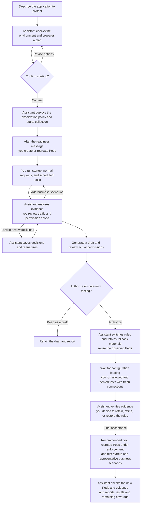
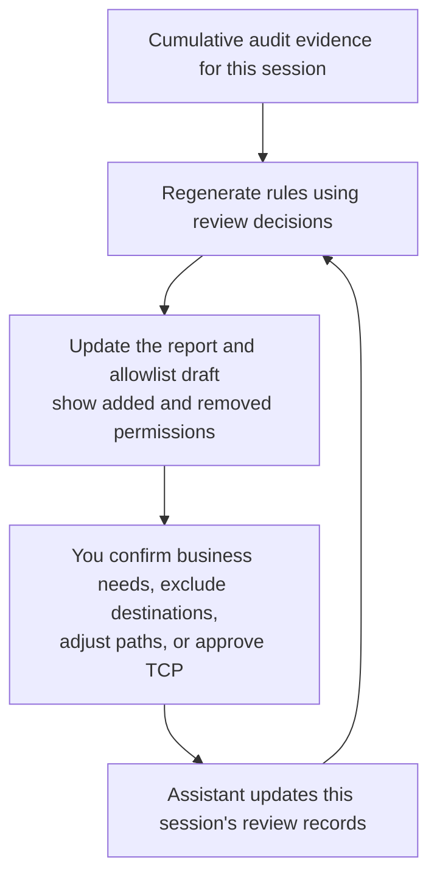
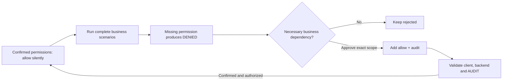
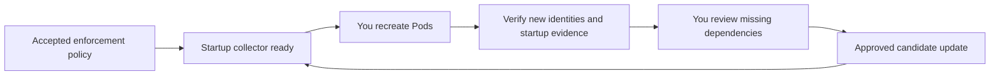

# vArmor Network Allowlist Advisor

English | [Chinese](README.zh_CN.md)

Specify a Kubernetes application in plain language. The assistant generates a vArmor NetworkProxy allowlist from real outbound traffic. You review which access the business needs, then test what is allowed and denied.

You do not need to learn policy custom resources (Policy CRDs) or script commands. During observation, network traffic is allowed and audited while existing system protection remains in place. After review and validation, the assistant enables allowlist enforcement only with your authorization.

Quick navigation:

- [Install and try it](#install-and-try-it) · [Target labels](#where-to-put-target-labels) · [Review suggestions](#review-allowlist-suggestions)
- [Adjust observation](#what-you-can-change-during-observation) · [Log collection](#how-logs-are-collected) · [Resource limits and denial review](#high-traffic-quiet-confirmed-rules-and-missing-permissions)
- [Validate and deliver](#validation-deployment-and-deliverables) · [Things to know](#things-to-know)

## Your responsibilities and the assistant's

| You | The assistant |
|---|---|
| Specify the application, business scenarios, and observation window | Check the environment, permissions, existing policies, and target matching |
| Confirm or revise the observation plan | Prepare policy drafts and create/update policies when authorized |
| Update application labels, create/recreate Pods, and run business scenarios | Start collection first, then check new Pod injection and audit |
| Decide which traffic is necessary for the business | Analyze logs, explain permission scope, and save your review decisions |
| Reuse observed Pods for tests and decide whether to enforce | Update allowlist drafts, check results, and switch policies when authorized |

**You manage application workload/Pod lifecycles.** The assistant does not create, update, roll out, or delete business workloads for you. Generated policies always set `updateExistingWorkloads: false`. When reusing a policy, the assistant also disables its original automatic update setting, retains a backup of the original object, and explains the change.



You can reuse this session's new Pods for additional business scenarios. Create new instances when you need more startup coverage. If observation has ended, start a new session with a new observation plan.

## What to prepare

- An assistant environment that can run local commands and access the target cluster, such as Codex or Claude Code. It needs Python 3.9+ and kubectl, with no additional Python packages.
- A working vArmor NetworkProxy installation, version v0.10 or later. The assistant checks compatibility against actual CRDs, proxies, permissions, and log capabilities, and validates policies before deployment.
- The cluster context, namespace, and workload name or stable Pod labels. Provide the policy name too if one already exists.
- A way to manage the target workload and business scenarios to cover, such as startup, normal requests, scheduled tasks, retries, and different replicas.

**Neither the policy nor the workload needs to exist yet.** A planned target or Pod labels are enough to prepare observation. If only the workload exists, the assistant creates a policy; if a compatible namespaced policy exists, it adjusts the original object.

Automatic merging currently supports `VarmorPolicy`. `VarmorClusterPolicy`, overlapping policies, and incompatible configurations require separate handling.

## Install and try it

### 1. Install the Skill

Extract the distribution archive to get a `varmor-network-advisor/` directory. Keep the entire directory, including `SKILL.md`, `scripts/`, `references/`, and `agents/`.

Copy the entire directory into your assistant's skills directory. For a Codex user-level installation:

1. Make sure the destination directory does not already exist.
2. Replace `/ABS/varmor-network-advisor` in the command with the absolute path to the extracted directory.
3. Run the copy command.

```sh
mkdir -p ~/.codex/skills
cp -R /ABS/varmor-network-advisor ~/.codex/skills/
```

Other installation locations:

| Assistant | User-level directory | Project-level directory |
|---|---|---|
| Codex | `~/.codex/skills/` | `/ABS/PROJECT/.agents/skills/` |
| Claude Code | `~/.claude/skills/` | `/ABS/PROJECT/.claude/skills/` |

After copying, you can move or delete the original extracted directory. To update, replace the installed copy.

If the current conversation has not discovered the Skill, ask the assistant to read the installed `SKILL.md`. Provide the file's absolute path.

### 2. Describe the target in natural language

The names below are examples; replace them with your own target. In Codex, you can say:

> Use $varmor-network-advisor to help restrict my order app's outbound access. Normal orders and order queries must work. I do not know how to write vArmor YAML; guide me through a test before deployment.

In Claude Code, use `/varmor-network-advisor` for the same request. You can also ask for a template without deployment or explicitly name an existing policy.

### 3. Confirm the observation plan

The assistant confirms the target and business needs, performs read-only checks, and prepares a policy draft. The plan distinguishes your requirements, suggested defaults, and environment findings. You can confirm starting or revise it first:

> Change the observation window to 30 minutes, keep the other options, and start with the revised plan.

The assistant gives a short plan summary and links the complete plan for review. After confirmation, it reports only changes. You can ask for collection settings and budget details at any time.

For a first interactive observation, allow at least **10 minutes**, or **15 minutes** for slow rollouts or several handoffs. These are recommendations, not enforced limits or guarantees of complete coverage. Scheduled jobs may need a longer business cycle.

You can choose a shorter window. Prepare the recreation and business request steps before collection starts.

Unspecified options use the defaults below. Existing policy settings are also included; for example, HTTPS decryption (MITM) scope is retained unless you request its removal.

Note: The observation policy changes the target's NetworkProxy rules to allow and audit. Check changes to existing network blocking when confirming the plan. Existing system protection is retained.

| Item | Suggested default and meaning |
|---|---|
| Observation window | At most 1 hour after collector startup; you can specify another duration or an exact deadline |
| Network scope | HTTP and TCP; MITM is disabled by default for new policies |
| Log scanning | Wait 30 seconds after each round; catch up no faster than the agreed minimum (default 5 seconds) |
| Pod discovery | Continuously watch new Pods, with LIST recovery checks every 5 seconds |
| Per-round processing | At most 4 MiB of new log content across sources; this is separate from returned-byte accounting |
| Returned audit bytes | At most 16 MiB per rolling 60 seconds, shared across evidence phases |
| Read concurrency and timeout | Read at most 2 log sources simultaneously; Kubernetes read rounds take at most 30 seconds and cannot exceed remaining observation time |
| Analysis | Check for new data every 5 minutes, update reports only when data changes, and analyze again at completion |
| Allowlist granularity | Preserve exact host, port, path, and method for visible HTTP; review TCP separately |
| Local capacity | Default session storage stop threshold of 512 MiB; stop and report when reached |

Policy deployment and collection have not started while the plan awaits confirmation. Relative observation time starts with the collector and includes preparation, waiting for Pod recreation, and business traffic. An absolute deadline does not move because of waiting.

If you explicitly request starting with the complete plan already shown, the assistant does not ask for confirmation again.

### 4. Create or recreate Pods after the readiness message

**Wait for the collector readiness message before creating or recreating Pods.** The assistant reports the actual deadline, remaining time, collection intervals, log sources, and label requirements. Starting collection first gives startup traffic a chance to be collected.

Before handing over, and again when you reply, the assistant checks collector health and remaining time. The readiness message describes the state at that check; it does not guarantee that the process will stay alive.

Each handoff starts with the current progress, who acts next, and the success
criteria. For example:

> The collector is ready until 15:30. Recreate the application and exercise order queries. The assistant will check new Pods and startup evidence.

`workflow-status.md` summarizes the stage and next action. Candidate changes
invalidate old verification. Saved successful checks do not establish the
current cluster state; technical details stay in linked reports.

Note: Handoff delays, collection failures, or expiry can make the message stale. The assistant explains the evidence gap before deciding the next step. Timeout diagnostics preserve the operation, stage, and time bound; they do not establish the root cause.

This session excludes Pod UIDs that existed before handoff, even if they already had a proxy. Create or recreate Pods with new UIDs; restarting a container inside the same Pod is not Pod recreation. Then tell the assistant:

> I have created or recreated the target Pods. Check the new Pods and proxy injection. I will run normal business traffic, retries, and scheduled tasks. Analyze the logs and tell me which scenarios are still missing.

Verified identities and collected evidence remain after new Pods are deleted, but final logs that were not read in time may be lost. Pod readiness alone does not prove proxy operation, audit, or startup coverage.

## Where to put target labels

By default, vArmor requires the target object to have the enable label and also match the policy target:

```yaml
sandbox.varmor.org/enable: "true"
```

| Policy target | Where you check or change labels |
|---|---|
| Deployment / StatefulSet / DaemonSet | The object's own `metadata.labels`; setting only Pod template labels is insufficient |
| Pod | The Pod's `metadata.labels` |
| Application managed by a custom controller | Use a Pod target; configure stable business labels and the enable label in the controller's Pod template |

The installed webhook selectors determine actual requirements. The assistant explains where you need to make changes. Labels on a custom CRD object do not necessarily propagate to its Pods. You can say:

> A custom controller manages this application. Match Pods with app=assistant in namespace=agents, using kind=Pod. I will update the controller's Pod template and recreate Pods.

This lifecycle workflow works with different controllers, but actual proxy injection, runtime compatibility, and audit still need checking.

## Review allowlist suggestions

The assistant first presents actual permissions and review items, then `candidate.yaml`. Check:

- Destinations and ports.
- Paths and request methods.
- Permission scope, including permissions added and removed this round.

Note: Observed activity is not automatically legitimate business traffic.

By default, HTTP candidates come from normal 2xx/3xx `AUDIT` requests. Upstream error responses need business review. Proxy `DENIED` events, failed connections, anomalous identities, and missing fields are not automatically allowed.

Available control granularity depends on the traffic:

| Scenario | What can be generated | What you need to know |
|---|---|---|
| Plaintext HTTP | Host, actual port, path, method | Exact matches by default; you decide whether to generalize dynamic paths |
| HTTPS with authorized MITM | Decrypted host, port, path, method | The application must trust the certificate authority (CA); check certificate pinning and mutual TLS (mTLS) compatibility |
| Undecrypted HTTPS | TLS Server Name Indication (SNI), actual port | Paths and methods do not restrict TLS passthrough; no domain is inferred without SNI |
| Other TCP | Complete IP and port | Rules require separate approval and may also allow HTTP/TLS to the same destination |

If you need HTTPS path control, say:

> Allow MITM for api.example.com. I will recreate Pods and run requests; check CA trust and actual path visibility. Keep downloads.example.com as TLS passthrough, controlled only by SNI and port.

Enabling MITM for the first time involves new Pods or mounts. Changes to observation configuration need a separate session; do not mix evidence from different decryption scopes.

Note: Keep normal certificate verification during tests. Using `curl -k` hides certificate problems.

### What does "save review decisions and reanalyze" mean?

Tell the assistant which traffic is necessary, which is outside normal business, and how you want matches to work. It saves these choices as **review records for this session**, then regenerates the report and allowlist draft using collected logs. You do not need to edit review files manually.



For example, an initial draft contains two exact plaintext HTTP paths, a telemetry domain, and a database connection awaiting review:

| Your decision | What changes after reanalysis |
|---|---|
| "The IDs in api.example.com's `/v1/projects/123` and `/v1/projects/456` are dynamic. Allow new project IDs with GET; keep unrelated administration paths at their existing exact scope." | Generalize to the `/v1/projects/` subtree; explain that it also allows the same method on other IDs and paths within that subtree |
| "telemetry.example.com is outside normal business. Keep excluding it." | Stop using that domain's evidence to generate rules; later analysis in this session reuses the decision |
| "10.0.0.8:5432 is a necessary database connection. Allow the complete IP/port." | Move it from pending TCP review to candidate authorization; explain that the whole TCP destination is allowed |

You can request these changes together:

> Save these review decisions, preserve my other existing choices, and reanalyze. Show permissions added and removed relative to the previous draft. Do not apply the candidate yet.

Review records are saved as `review.json` in the session directory and reused by later analysis. Tell the assistant when you want to change or revoke them. These choices apply only to this session, not to every application.

Reanalysis uses saved evidence and can run after observation stops. It does not require collecting again or recreating Pods. Uncovered business scenarios still need separate collection and traffic you run.

Necessary TCP connections without audit remain visible as pending requirements. Explicitly approving the entire IP/port adds them to the same `candidate.yaml`, marked as user-declared and not verified. Reanalysis preserves the decision and distinguishes declared requirements from observed evidence.

Enforcement verification uses separate evidence. A candidate policy change makes the old verification result stale.

Path rules currently support exact matches and prefixes. A prefix cannot allow only numeric IDs while excluding other descendants such as `details` or `admin`.

If you do not accept that wider scope, the assistant can retain an agreed finite list. The report explains which dynamic requests remain unsupported. A successful test of that list does not make it suitable for unrestricted future IDs.

**Saving decisions and reanalyzing updates only local review records, reports, and drafts; it does not automatically change the live policy.**

Note: Exclusions filter modeling inputs without generating explicit deny rules. Another broad permission may still allow the destination. Check the expanded access scope before approving TCP, widening paths, or removing method restrictions.

## What you can change during observation

You can add business scenarios, revise review decisions, and request shortening, extending, or stopping observation. To change a running window, say:

| Your request | How it is interpreted |
|---|---|
| "Observe for another 30 minutes" | Keep observing for 30 minutes from this request |
| "Extend by one hour" | Add one hour to the current deadline |
| "Observe for two hours total" | Calculate the new deadline from the original collector startup |
| "End at 18:00 today" | Adjust the deadline after establishing the date and timezone |
| "End now" | Request collection stop and a final report |

An explicit change request does not require repeated confirmation. The assistant verifies the acknowledgment that the change took effect, then reports the old deadline, new deadline, and actual remaining time.

Note: Changes are processed at a safe point after the current round and may be delayed. **Submission does not mean the change has taken effect.** Even a request submitted before expiry may not be applied in time.

Changing the deadline preserves evidence and read positions without requiring Pod recreation. It does not automatically increase the storage threshold. Ended or expired observation requires a new session; the assistant explains the gap and new handoff requirements.

Five-minute analysis runs locally; it does not mean the model automatically sends a message every five minutes. Explicitly request notifications across conversations if you want them. Notification capability depends on the host's scheduling tools and whether the local process stays alive.

## How logs are collected

The assistant runs a local collector until your agreed deadline. **Each audit-file read uses a separate `kubectl exec`, which exits after returning a bounded batch.** An audit exec connection does not stay open throughout observation.

A separate Pod watch normally stays connected to discover new and deleted Pods. It can reconnect; the assistant reports risks when discovery is interrupted.

| Source | How it is selected |
|---|---|
| Existing vArmor Agent | Default for ordinary nodes; read the node's `/var/log/varmor/violations*.log` through its Agent container |
| NetworkProxy sidecar | Default for micro-VM Pods with container-local normalized audit files |
| Temporary reader Pod | Explicitly authorized snapshot fallback with read-only node log mounts; not currently part of bounded `monitor` |
| Saved logs | Offline analysis; no live Pod identity or file-continuity guarantee |

`auto` chooses Agent or sidecar from actual Pod volume topology. Agent and proxy standard output (stdout) is useful for diagnostics, but does not generally replace normalized audit files.

Files exported through SSH or an existing log platform can be imported for analysis. The collector does not automatically connect to SSH or log platforms.

```mermaid
sequenceDiagram
    participant C as Local collector
    participant F as Agent or sidecar
    loop Until deadline or explicit stop
        C->>F: Short exec: stat files, read budgeted increments
        F-->>C: Metadata and bytes; exec exits
        Note over C: Verify identity and fingerprint, save complete events and checkpoints
        Note over C: Wait for next interval; no audit exec remains open
    end
```

<details>
<summary>Read positions, log rotation, and byte accounting</summary>

The collector saves file identity (device/inode) and the read offset through complete log lines:

- `stat` supplies file identity and size.
- `dd` seeks and reads; `head`/`tail` trim returned bytes inside the container.
- Up to 64 bytes before a checkpoint are reread to check a SHA-256 fingerprint.
- Normal records advance the checkpoint only through complete newline-terminated lines; a partial final line stays unread for a later scan.
- Detected oversized lines discarded by the collector are recorded as gaps, not counted as complete evidence.

On rename rotation, the retained old file usually keeps its identity. The collector reads its unread tail before the new file. If a known unread file disappears, the report records a confirmed log-source gap. Shrinkage or a changed checkpoint fingerprint records a suspected reset.

Note: These checks cannot detect every overwrite or event dropped before file writing. A file created and removed between scans may also be missed. Missing source bytes do not establish how many target events were lost.

The per-round processing budget caps new log content. A separate rolling quota caps audit exec output, including metadata, framing, fingerprint overlap, and rereads.

The collector reserves bytes before reading, caps returned output inside the container, and saves actual usage afterwards. Failed transfers with uncertain usage are conservatively charged at the reserved amount. Observation and enforcement evidence phases share the ledger.

If quota runs out, the collector keeps its position and reports pressure, then waits for more quota or stops at the deadline. It does not download a full file and discard excess bytes, or fall back to an unbounded snapshot.

</details>

You can ask: “Show the current source, last successful read, backlog and remaining budget; keep the agreed limits.” You do not need to operate the scripts.

## High traffic, quiet confirmed rules, and missing permissions

You can say:

> Keep collection modest: scan every 30 seconds, no faster than five seconds
> when busy, at most two simultaneous reads and 16 MiB of returned audit data
> per minute. Keep those limits even if collection falls behind.

The assistant shows resource limits before you start, and the collector follows them. Returned audit bytes include metadata, framing, rereads, and fingerprint overlap. API, watch, and transport protocol overhead are excluded, so this is not a total network bandwidth, CPU, or memory quota.

Local storage has a stop threshold, defaulting to 512 MiB; transactions and bookkeeping may add overhead. If backlog remains when limits are reached, the assistant explains the risk of missing evidence and does not automatically raise the limits.

Observation continues to allow and audit traffic. After you confirm permission scopes and authorize enforcement, confirmed rules can allow silently without logging normal requests. Unauthorized traffic is still rejected and produces `DENIED`.

Explanation: Silent rules use `allow` without changing varmor-agent. Observation's catch-all audit remains active; adding `allow` cannot cancel its audit.



> These health and order-query permissions are correct. Stop logging those
> normal requests. Show me rejected dependencies and ask before adding them.

The assistant reuses verified Pods and starts a separate enforcement evidence window with a deadline, preserving resource limits. You run the business scenarios. The assistant groups denials by the fields actually visible:

- HTTP method and path.
- TLS domain and port.
- TCP IP and port.

Rejection does not prove that the business needs the access. After your approval, the assistant adds the exact missing permissions to the same `candidate.yaml`. It saves your reason and the `DENIED` source; other permissions remain unchanged.

New permissions start with auditing to verify success, then can be made silent after confirmation. Debug access or wrong methods you reject are not automatically allowed.

Note: Blocked prerequisites may hide later dependencies. Rerun the complete scenario after adding a required permission.

Quiet checks need:

- Successful client results and backend results.
- Confirmation that the actual proxy configuration is loaded.
- A read within the agreed limits that covers the request window.

The absence of audit records alone does not prove success. Resource-limited or unfinished reads remain marked as insufficient evidence. Reports separate successful observation, reviewed `DENIED` additions, audit settings, and subsequent validation. Replay coverage does not establish complete business coverage.

The assistant saves actual test receipts. The checker validates output content,
byte hashes, Pod identity and the traffic window. Confirmation flags alone
cannot pass verification. Client and backend evidence must come from real tests.

Common plaintext HTTP and TLS passthrough rules support automatic checks of
active proxy permissions. MITM, raw TCP grants and other unsupported layouts
require separate diagnostics. Quiet checks with missing configuration proof
remain insufficient; the assistant explains the applicable visibility limits.

Your decisions are saved in `refinement.json`; enforcement logs are kept in separate directories. You do not need to edit these files or learn script commands.

### Withdraw or restore previously allowed access

> The refresh feature has been retired. Remove its permission and keep the other
> requests working.

The assistant removes the selected candidate rule and saves the withdrawal reason and prior approval. Reanalysis cannot restore that permission, and no new `DENIED` is required. Its previous silence approval is cleared.

Restoring access requires your explicit approval. The restored rule starts with auditing and is verified again before a later silence decision.

Note: Other prefix, domain, or TCP permissions may still allow the destination after a rule is removed. Reports list possible overlaps. The assistant checks the actual configuration, then you test with fresh connections.

Excluding a domain's logs from recommendations only filters modeling input; it does not withdraw existing permissions. Withdrawing all available permissions creates an explicitly marked deny-all candidate. The assistant explains its impact, and deployment still requires your authorization.

Observation and enforcement reports both use your chosen language. Ask for Chinese or English at any time. Later analysis retains your choice without restarting collection or changing the Policy.

### Keep an explicit prohibition while refining the allowlist

> Keep debug access blocked even if I later approve a broader business rule.

The assistant explains the actual denial scope, then saves your approved rule separately. Reanalysis, language changes, silent allow rules, and withdrawal of other permissions preserve the deny rule. Removing it requires separate explicit approval. Reports list added and removed allow and deny rules.

Manually edited candidate files are preserved. The assistant reconciles and saves review decisions before regenerating them.

Plaintext HTTP or MITM can deny access by path and method. Undecrypted TLS does not expose these fields.

Warning: The same HTTP deny rule also blocks the entire matching SNI/port. The current policy API has no HTTP-only flag. The assistant must explain this effect before approval and cannot promise protocol separation that the API does not express.

Rejecting an allow suggestion or withdrawing a permission does not itself create an explicit deny rule.

## Validation, deployment, and deliverables

An allowlist draft defaults to denying unauthorized access, but generating it does not itself enable enforcement. You can first ask:

> Show this session's actual permissions, pending TCP, collection gaps, and uncovered scenarios. Then provide the candidate policy and allowed/denied test requirements. Do not deploy enforcement yet.

Changing allowlist rules, switching to enforcement, or restoring observation normally reuses this session's injected Pods. The assistant waits for configuration loading and checks actual behavior, then you test with fresh connections.

Note: Missing injection or new mounts, environment variables, or redirection settings may require creating or recreating Pods. Check these conditions when enabling MITM for the first time too.

For final acceptance, the assistant recommends recreating Pods under the accepted enforcement policy. This removes connections retained from observation and helps reveal missing startup dependencies. You test startup, normal business, reconnects, and representative scheduled tasks. The assistant checks the new Pods and evidence; passing tests does not prove that all business scenarios are covered.

The assistant starts a separate startup collector with a deadline **before** you recreate Pods. It excludes old Pods and verifies new target Pod identities. If enforcement prevents an application from becoming Ready, `DENIED` events with verified identities can still be reviewed. Unverifiable identities or inaccessible logs are reported as gaps.

After you approve missing startup dependencies, the assistant updates the candidate and prepares a new startup collection. Wait for the readiness message before recreating Pods to verify it. Original observation evidence and resource limits remain intact.



You execute requests; the assistant checks client results, backend records, and network audit. Test scenarios include:

- Normal business.
- Wrong methods and neighboring paths.
- Unknown Host/SNI.
- Necessary TCP connections and MITM requests.

Note: Policy readiness or server-side validation does not replace real request verification.

After confirming business coverage and test results, explicitly authorize switching the target policy. The assistant retains a current-policy backup and rollback materials for observation rules, always keeping `updateExistingWorkloads: false`.

**Stopping collection leaves the deployed policy unchanged.** Observation remains allow-and-audit after collection stops; enforcement remains enforcing. Expiry does not switch modes, remove the proxy, or delete the application.

Warning: Check the automatic update setting before restoring the original policy. Removing the initially injected proxy or MITM mounts requires Pod recreation that you manage.

| Main artifact | Purpose |
|---|---|
| `report.md` | Actual permissions, added/removed permissions, pending TCP, uncovered behavior, and next steps |
| `workflow-status.md` / `workflow-status.json` | Current stage, next actor/action and evidence links; not current deployment proof |
| `candidate.yaml` | Draft for review; normally absent without acceptable rules; explicit withdrawal of all grants produces a marked deny-all draft |
| `review.json` | Saved business review decisions reused in this session |
| `refinement.json` | DENIED, silence, grant withdrawal/restoration and explicit deny constraints, with history, reasons and approval evidence |
| `resource-usage.json` | Shared rolling audit-byte ledger across observation and enforcement phases |
| `collector.json` | Actual plan, readiness and collection state, deadline-change acknowledgments, gaps, and stop reason |
| `observe.yaml` / `validation.yaml` | Allow-and-audit policies and validation/rollback materials |
| `original-policy.json` | Original object saved when reusing an existing policy |
| Separate `verification.md` / `verification.json` / `denials.json` | Validation checklist, policy/Pod identities, time window, evidence results and denial review items |
| `analysis.json` / `events.sqlite` | Structured analysis and cumulative audit evidence |

### Readable policy files

`candidate.yaml`, `observe.yaml`, and `validation.yaml` use block YAML. Session state, analysis results, and review records use JSON. No extra Python package is required, and legacy JSON-formatted policy files remain readable.

Use the Kubernetes JSON export when importing an existing Policy. The built-in reader supports only generated YAML, not arbitrary YAML syntax.

## Things to know

- **Coverage describes existing evidence only.** A 100% replay result, a stable candidate, or no new traffic does not prove coverage of low-frequency tasks, retries, failover, or all replicas. Verify real traffic before enforcement.
- **Logs may have gaps.** The collector tracks retained rotation files. It reports a confirmed gap when known unread bytes disappear, and suspected gaps for interrupted reads, file resets, and similar risks. Shared node log loss may not reveal how many target events were affected. Drops before writing may be invisible. "No detected gap" is not a completeness guarantee.
- **Keep the collection environment running.** Host sleep, restart, or tool exit may interrupt observation. Recovery before expiry retains the latest applied deadline and reports interruption risk without automatically extending it. Final micro-VM logs may disappear when the sidecar is deleted.
- **Interrupted time is not observation.** After resuming beyond the deadline, the collector starts no new reads. Detected clock jumps or long heartbeat interruptions are marked as suspected gaps and excluded from sampled runtime. Runtime does not establish business coverage.
- **The capacity threshold is not a hard disk quota.** The default 512 MiB threshold is checked between rounds, so the current batch and final report may exceed it. Old evidence is not deleted to make room. Prefer an existing persistent log backend at larger scale.
- **Check permission scope.** Before new Pods are scheduled, the assistant checks node log sources in the specified Agent scope, within authorization. Continuous collection needs sh, stat, dd, head and tail in log containers. Missing capabilities require diagnosis or an explicitly agreed alternative; an existing resource plan cannot fall back to an unbounded live snapshot. Offline inputs have different continuity limits. If a fallback reader needs an image, provide one your environment can pull.
- **Understand network boundaries.** This allowlist does not prove coverage of UDP/DNS, QUIC, loopback, or traffic bypassing TCP redirection. Network audit has Pod granularity and cannot distinguish every application container/process in the same Pod. A long-lived connection still open when observation ends may not yet have emitted its audit. Tell the assistant about required connections missing from the report; their absence does not mean they are unnecessary.
- **Protect local files.** Sessions use private directories and strip path queries before storage, but paths and retained fields can still be sensitive. Check business information before sharing reports.

## Common questions

| Issue | What to tell the assistant |
|---|---|
| kubectl works, but there is no audit | "Check proxy injection, audit rules, log sources, and read permissions. Explain the blocking evidence." |
| No proxy was injected | "Check the policy target, enable label location, and webhook selectors. Tell me what I need to change." |
| Agent discovery failed | Provide the vArmor installation namespace, Agent labels, or container name so the assistant can verify the read source |
| HTTPS traffic has no visible path | "Explain whether traffic is passthrough, and assess MITM compatibility for necessary domains." |
| HTTP 403 was excluded from the candidate | "Distinguish upstream business errors from proxy denial." Necessary upstream errors can be accepted after review; proxy denials are not automatically allowed |
| No candidate.yaml was generated | "Explain whether the cause is empty data, exclusions, or unacceptable fields, and suggest additional scenarios." Old candidates are not presented as current recommendations |
| A collection gap was detected | "Explain the detection window, log source, and uncertain impact. I will rerun the affected scenarios." |
| The collector stopped early | "Check the deadline, process, permissions, and storage threshold. Explain whether recovery is possible or a new session is needed." |
| Analyze denials after switching to the allowlist | "Handle post-deployment denial audit separately." The original observation session has fixed observation configuration; modes are not mixed and permissions are not automatically added |

The following English references guide the assistant through rule semantics and troubleshooting. You do not need to read them for everyday use:

- [Network authorization boundaries](references/networkproxy.md).
- [Observation and collection continuity](references/observation-and-collection.md).
- [Review decisions and notification scheduling](references/review-and-scheduling.md).
- [Separate enforcement verification](references/verification.md).

<!-- package:source-only:start -->
## Maintainer notes

<details>
<summary>Development installation, distribution packaging, and regression checks</summary>

### Install from source for development

When updating the Skill from a repository, the installer creates symbolic links so source changes immediately appear at the installation location. Run it in this directory:

```sh
# Install for a project; refuse to overwrite a different existing installation.
python3 install.py --tool codex --project /ABS/PROJECT

# User-level installation for both Codex and Claude Code.
python3 install.py --tool both
```

The installer creates relative symlinks only. It does not detect or install assistants or dependencies.

Note: Moving the source directory alone breaks links. Verify and remove old links, then reinstall from the new location. Moving source and links together works if their relative locations stay the same. Do not commit links to absolute paths on your machine.

### Package for distribution

Packaging requires Python 3.9+ and does not access the cluster. Run in this directory, or specify the path to `package.py` from anywhere. Inputs always come from the script's directory.

```sh
# Slim package for users: runtime files and English/Chinese guides, 14 files total.
python3 package.py

# Full package: also includes installation, packaging, and regression tools.
python3 package.py --full

# Choose an output location.
python3 package.py --output /ABS/RELEASE/varmor-network-advisor-skill.zip
```

Default outputs are `dist/varmor-network-advisor-skill.zip` and `dist/varmor-network-advisor-full.zip`, respectively. Both extract to `varmor-network-advisor/` and support copy installation using the user guide. The full package also supports the development installer.

Packaging uses an explicit file list:

- It excludes `evidence/`, local sessions, caches, old ZIPs, and unlisted files.
- Update the list when adding runtime resources or tests.
- Both packages include English and Chinese READMEs; `SKILL.md` and `references/` are in English.
- The slim package strips maintainer notes from both READMEs.
- Identical inputs produce identical bytes in the same Python/zlib environment; old outputs are replaced only after a successful build.
- Do not commit generated ZIPs or `dist/`; use them as release attachments.

### Regression checks

```sh
PYTHONDONTWRITEBYTECODE=1 python3 -m unittest discover -s tests -v
python3 tests/smoke_cluster.py --context CONTEXT --image APPROVED_CURL_IMAGE --output /ABS/NEW_HTTP_RESULT
python3 tests/smoke_tls_tcp.py --context CONTEXT --image APPROVED_CURL_IMAGE --output /ABS/NEW_TLS_RESULT
python3 tests/smoke_collector.py --context CONTEXT --image APPROVED_CURL_IMAGE --output /ABS/NEW_COLLECTOR_RESULT
```

Live tests create an isolated namespace and their own resources, then delete them. Provide a pullable curl image through `--image`, including sh, cat, and BusyBox nc.

HTTPS tests also use the cluster's existing Envoy image and require local openssl. They read only the test policy's temporary CA to sign their own backend certificate. Private keys are not recorded in validation evidence, and clients always verify certificates.

These tools are for maintainer regression testing and do not replace user management of business workloads. The assistant starts continuous collection according to observation authorization. Distribution packages do not create native notification schedules themselves.

</details>
<!-- package:source-only:end -->
