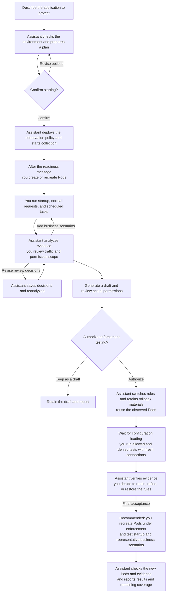
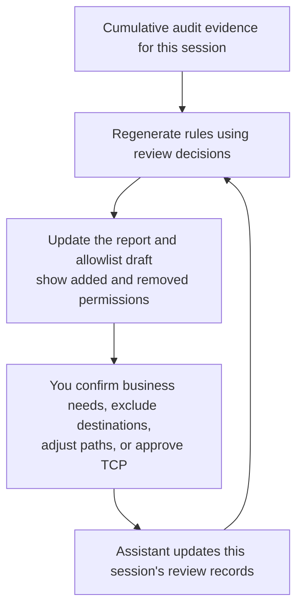
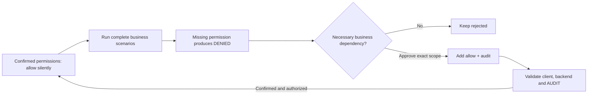
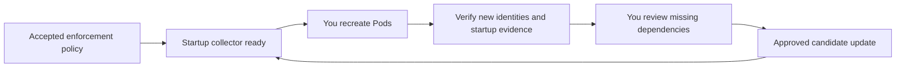

# vArmor Network Allowlist Advisor

English | [Chinese](README.zh_CN.md)

Tell the assistant which Kubernetes application you want to protect, in plain language. It collects real outbound traffic evidence, helps you review business needs, and produces an explainable, verifiable vArmor NetworkProxy allowlist.


You do not need to learn the Policy CRD or the built-in script commands. Existing system protection is preserved. Network observation starts by allowing and auditing traffic; after review and validation, the assistant switches to a default-deny allowlist only with your authorization.

Start here: [Install and try it](#install-and-try-it) · [Target labels](#where-to-put-target-labels) · [Review suggestions](#review-allowlist-suggestions) · [Adjust observation](#what-you-can-change-during-observation) · [Collection and limits](#how-logs-are-collected) · [Quiet rules and denials](#high-traffic-quiet-confirmed-rules-and-missing-permissions) · [Validate and deliver](#validation-deployment-and-deliverables) · [Things to know](#things-to-know)

## Your responsibilities and the assistant's

| You | The assistant |
|---|---|
| Specify the application, business scenarios, and observation window | Check the environment, permissions, existing policies, and target matching |
| Confirm or revise the observation plan | Prepare policy drafts and create/update policies when authorized |
| Update application labels, create/recreate Pods, and run business scenarios | Start collection first, then check new Pod injection and audit |
| Decide which traffic is necessary for the business | Analyze logs, explain permission scope, and save your review decisions |
| Reuse observed Pods for tests and decide whether to enforce | Update allowlist drafts, check results, and switch policies when authorized |

**You manage application workload/Pod lifecycles.** The assistant does not create, update, roll out, or delete business workloads for you. Generated policies always set `updateExistingWorkloads: false`. When reusing a policy, the assistant also disables its original automatic update setting, retains a backup of the original object, and explains the change.



You can run additional scenarios on the new Pods from this session without recreating them each time. When you need more startup coverage, manage new instances yourself. If observation has already ended, start a new session and confirm a new plan.

## What to prepare

- An assistant environment that can run local commands and access the target cluster, such as Codex or Claude Code. It needs Python 3.9+ and kubectl, with no additional Python packages.
- A working vArmor NetworkProxy installation. This Skill targets vArmor v0.10 and later. The assistant checks actual CRDs, proxies, permissions, and log capabilities; later releases are assessed by their actual interfaces, and policies are validated before deployment.
- The cluster context, namespace, and workload name or stable Pod labels. Provide the policy name too if one already exists.
- A way to manage the target workload and business scenarios to cover, such as startup, normal requests, scheduled tasks, retries, and different replicas.

**Neither the policy nor the workload needs to exist yet.** A planned target or Pod labels are enough to prepare observation. If only the workload exists, the assistant creates a policy; if a compatible namespaced policy exists, it adjusts the original object. Automatic merging currently supports `VarmorPolicy`. `VarmorClusterPolicy`, overlapping policies, and incompatible configurations require separate handling.

## Install and try it

### 1. Install the Skill

Extract the distribution archive to get a `varmor-network-advisor/` directory. Keep the entire directory, including `SKILL.md`, `scripts/`, `references/`, and `agents/`.

Copy it into your assistant's skills directory. For a Codex user-level installation, replace `/ABS/varmor-network-advisor` with the absolute path to the extracted directory and first make sure the destination does not already exist:

```sh
mkdir -p ~/.codex/skills
cp -R /ABS/varmor-network-advisor ~/.codex/skills/
```

Other installation locations:

| Assistant | User-level directory | Project-level directory |
|---|---|---|
| Codex | `~/.codex/skills/` | `/ABS/PROJECT/.agents/skills/` |
| Claude Code | `~/.claude/skills/` | `/ABS/PROJECT/.claude/skills/` |

After copying, you can move or delete the original extracted directory. To update, replace the installed copy. If the current conversation has not discovered the Skill, ask the assistant to read the absolute path to the installed `SKILL.md`.

### 2. Describe the target in natural language

The names below are examples; replace them with your own target. In Codex, you can say:

> Use $varmor-network-advisor to help restrict my order app's outbound access. Normal orders and order queries must work. I do not know how to write vArmor YAML; guide me through a test before deployment.

You need not know observation, path depths, or collection commands. The assistant asks for the target and business needs, checks the environment, and prepares a plan for confirmation.

In Claude Code, use `/varmor-network-advisor` for the same request. You can also ask for a template without deployment or explicitly name an existing policy.

### 3. Confirm the observation plan

The assistant first performs read-only checks and prepares a policy draft. It shows the final proposal, identifying your requirements, suggested defaults, and environment findings. You can confirm starting or revise it first:

> Change the observation window to 30 minutes, keep the other options, and start with the revised plan.

The assistant starts with a short business summary and links a complete plan for review: target, duration, business scenarios, material permission changes, and your next action. You can ask for collection/budget details; after confirmation, it reports changes without repeating the table. For a first interactive run, allow at least **10 minutes**, or **15 minutes** for slow rollouts or several handoffs. These are recommendations, not enforced limits or guarantees of coverage. A scheduled job may need a longer business cycle. You can choose a shorter window; prepare the recreation and request steps before collection starts.

For unspecified options, the suggested defaults are below. Actual existing policy settings are also included; for example, an existing MITM scope is not removed just because you did not mention it.

The observation policy changes the target's NetworkProxy network rules to allow and audit. Review any change to existing network blocking when confirming the plan. Existing system protection is retained.

| Item | Suggested default and meaning |
|---|---|
| Observation window | At most one hour after collector startup; you can specify another duration or an exact deadline |
| Network scope | HTTP and TCP; MITM is disabled by default for new policies |
| Log scanning | Wait 30 seconds after each round; catch up no faster than the agreed minimum (default 5 seconds) |
| Pod discovery | Continuously watch new Pods, with LIST recovery checks every five seconds |
| Per-round processing | At most 4 MiB of new log content across sources; this is separate from returned-byte accounting |
| Returned audit bytes | At most 16 MiB per rolling 60 seconds, shared across evidence phases |
| Read concurrency and timeout | At most two simultaneous audit reads; Kubernetes read rounds have a 30-second deadline, also bounded by remaining observation time |
| Analysis | Check for new data every five minutes, update reports only when data changes, and analyze again at completion |
| Allowlist granularity | Preserve exact host, port, path, and method for visible HTTP; review TCP separately |
| Local capacity | Default session storage stop threshold of 512 MiB; stop and report when reached |

Deployment and collection have not started while the plan awaits confirmation, so relative duration has not begun. After confirmation, collector preparation, waiting for your Pod recreation, and business traffic all count toward the launched window. An absolute deadline does not move because of waiting. If you explicitly request starting with the complete plan already shown, the assistant does not ask for confirmation again.

### 4. Create or recreate Pods after the readiness message

The assistant reports the actual deadline and remaining time, collection/analysis intervals, log sources verified as ready, and label requirements. **Wait for the collector readiness message before operating the application**, so startup traffic has a chance to be collected.

Before handing over, and again when you reply, the assistant checks current local collector health and remaining time. The message describes readiness at that check, not a promise that the process will stay alive. If a delayed handoff, failure or deadline makes it stale, the assistant explains the evidence gap before requesting more application work. Timeout diagnostics identify the operation, stage and time bound; they do not by themselves identify the cause.

This session excludes Pod UIDs that existed before handoff, even if they already had a proxy. Create or recreate Pods with new UIDs; restarting a container inside the same Pod is not Pod recreation. Then tell the assistant:

> I have created or recreated the target Pods. Check the new Pods and proxy injection. I will run normal business traffic, retries, and scheduled tasks. Analyze the logs and tell me which scenarios are still missing.

Verified identities and collected evidence remain after new Pods are deleted, but final logs that were not read in time may be lost. Pod readiness alone does not prove proxy operation, audit, or startup coverage.

## Where to put target labels

By default, vArmor requires the target object to have the enable label and also match the policy target:

```yaml
sandbox.varmor.org/enable: "true"
```

| Policy target | Where you check or change labels |
|---|---|
| Deployment / StatefulSet / DaemonSet | The object's own `metadata.labels`; setting only Pod template labels is insufficient |
| Pod | The Pod's `metadata.labels` |
| Application managed by a custom controller | Use a Pod target; configure stable business labels and the enable label in the controller's Pod template |

The installed webhook selectors determine actual requirements. The assistant explains where you need to make changes. Labels on a custom CRD object do not necessarily propagate to its Pods. You can say:

> A custom controller manages this application. Match Pods with app=assistant in namespace=agents, using kind=Pod. I will update the controller's Pod template and recreate Pods.

This lifecycle workflow works with different controllers, but actual proxy injection, runtime compatibility, and audit still need checking.

## Review allowlist suggestions

The assistant first presents actual permissions and review items, then `candidate.yaml`. Review destinations, ports, paths, methods, permission scope, and permissions added/removed this round. Observed activity is not automatically legitimate business traffic.

By default, HTTP candidates come from normal 2xx/3xx `AUDIT` requests. Upstream error responses need business review. Proxy `DENIED` events, failed connections, anomalous identities, and missing fields are not automatically allowed.

Available control granularity depends on the traffic:

| Scenario | What can be generated | What you need to know |
|---|---|---|
| Plaintext HTTP | Host, actual port, path, method | Exact matches by default; you decide whether to generalize dynamic paths |
| HTTPS with authorized MITM | Decrypted host, port, path, method | The application must trust the CA; check certificate pinning, mTLS, and other compatibility issues |
| Undecrypted HTTPS | SNI, actual port | Paths and methods do not restrict TLS passthrough; no domain is inferred without SNI |
| Other TCP | Complete IP and port | Rules require separate approval and may also allow HTTP/TLS to the same destination |

If you need HTTPS path control, say:

> Allow MITM for api.example.com. I will recreate Pods and run requests; check CA trust and actual path visibility. Keep downloads.example.com as TLS passthrough, controlled only by SNI and port.

Enabling MITM for the first time involves new Pods or mounts. When changing observation configuration, arrange a separate observation session rather than mixing different decryption scopes in one evidence set. Keep normal certificate verification; do not hide problems with `curl -k`.

### What does "save review decisions and reanalyze" mean?

Tell the assistant which traffic is necessary, which is outside normal business, and how you want matches to work. It saves these choices as **review records for this session**, then regenerates the report and allowlist draft using collected logs. You do not need to edit review files manually.



For example, an initial draft contains two exact plaintext HTTP paths, a telemetry domain, and a database connection awaiting review:

| Your decision | What changes after reanalysis |
|---|---|
| "The IDs in api.example.com's `/v1/projects/123` and `/v1/projects/456` are dynamic. Allow new project IDs with GET; keep unrelated administration paths at their existing exact scope." | Generalize to the `/v1/projects/` subtree; explain that it also allows the same method on other IDs and paths within that subtree |
| "telemetry.example.com is outside normal business. Keep excluding it." | Stop using that domain's evidence to generate rules; later analysis in this session reuses the decision |
| "10.0.0.8:5432 is a necessary database connection. Allow the complete IP/port." | Move it from pending TCP review to candidate authorization; explain that the whole TCP destination is allowed |

You can request these changes together:

> Save these review decisions, preserve my other existing choices, and reanalyze. Show permissions added and removed relative to the previous draft. Do not apply the candidate yet.

Review records are saved as `review.json` in the session directory and reused by later analysis. Tell the assistant when you want to change or revoke them. Reanalysis uses saved evidence from this session and can run after observation stops; it does not require collecting again or recreating Pods. These choices are not global preferences for every application. A user-declared connection is clearly distinguished from observed evidence. Uncovered business scenarios still require planned collection and traffic you run.

**Saving decisions and reanalyzing updates only local review records, reports, and drafts; it does not automatically change the live policy.** Exclusions filter modeling inputs rather than generating explicit deny rules, so another broad permission may still allow the destination. Check the actual expansion of access when approving TCP, widening paths, or removing method restrictions.

Necessary TCP connections without audit remain visible as pending requirements. Explicitly approving the entire IP/port adds them to the same candidate.yaml with a user-declared origin and a not-verified status. Reanalysis preserves the decision. Enforcement verification uses separate evidence; a later policy change makes the old result stale.

Path rules currently support exact matches and prefixes. A prefix cannot allow
only numeric IDs while excluding other descendants such as `details` or `admin`.
If you do not accept that wider scope, the assistant can retain an agreed finite
list and explain which dynamic requests remain unsupported. A successful test of
that list does not make it suitable for unrestricted future IDs.

## What you can change during observation

You can add business scenarios, revise review decisions, and request shortening, extending, or stopping observation. To change a running window, say:

| Your request | How it is interpreted |
|---|---|
| "Observe for another 30 minutes" | Keep observing for 30 minutes from this request |
| "Extend by one hour" | Add one hour to the current deadline |
| "Observe for two hours total" | Calculate the new deadline from the original collector startup |
| "End at 18:00 today" | Adjust the deadline after establishing the date and timezone |
| "End now" | Request collection stop and a final report |

An explicit change request does not require repeated confirmation. After submission, the assistant verifies the application acknowledgment before reporting the old deadline, new deadline, and actual remaining time. Changes are processed at a safe point after the current round and may be delayed. **Submission does not mean the change has taken effect**; even a request submitted before expiry may not be applied in time.

Changing the deadline preserves evidence and read positions without requiring Pod recreation. It does not automatically increase the storage threshold. Ended or expired observation requires a new session; the assistant explains the gap and new handoff requirements.

Five-minute analysis runs locally; it does not mean the model automatically sends a message every five minutes. Explicitly request notifications across conversations if you want them. Notification capability depends on the host's scheduling tools and whether the local process stays alive.

## How logs are collected

The assistant runs a local collector until your agreed deadline. **Each audit-file read uses a short-lived `kubectl exec`, which exits after returning a bounded batch. It does not keep one audit exec connection open throughout observation.** A separate Pod watch normally stays connected to discover new/deleted Pods; it can reconnect, and interrupted discovery is reported.

| Source | How it is selected |
|---|---|
| Existing vArmor Agent | Default for ordinary nodes; read the node's `/var/log/varmor/violations*.log` through its Agent container |
| NetworkProxy sidecar | Default for micro-VM Pods with container-local normalized audit files |
| Temporary reader Pod | Explicitly authorized snapshot fallback with read-only node log mounts; not currently part of bounded `monitor` |
| Saved logs | Offline analysis; no live Pod identity or file-continuity guarantee |

`auto` chooses Agent or sidecar from actual Pod volume topology. Agent/proxy stdout is useful for diagnostics, but does not generally replace normalized audit files. SSH or an existing log platform can supply files for import; automatic SSH/platform collection is not implemented.

```mermaid
sequenceDiagram
    participant C as Local collector
    participant F as Agent or sidecar
    loop Until deadline or explicit stop
        C->>F: Short exec: stat files, read budgeted increments
        F-->>C: Metadata and bytes; exec exits
        Note over C: Verify identity and fingerprint, save complete events and checkpoints
        Note over C: Wait for next interval; no audit exec remains open
    end
```

The collector remembers file identity (device/inode) and the position through which complete log lines have been processed. `stat` supplies identity and size; `dd` seeks and reads, while `head`/`tail` trim returned bytes inside the container. Up to 64 bytes before a checkpoint are reread to check a SHA-256 fingerprint. Normal records advance the checkpoint only through complete newline-terminated lines; a partial final line stays unread for a later scan. Detected oversized lines discarded by the collector are recorded as gaps, not silently counted as complete evidence.

On rename rotation, the retained old file usually keeps its identity and its unread tail is processed before the new active file. If a known unread file disappears, the report records a confirmed log-source gap. Shrinkage or a changed checkpoint fingerprint records a suspected reset. These checks cannot detect every overwrite, a file created and removed between scans, or events dropped before file writing; missing source bytes do not establish how many target events were lost.

The per-round processing budget caps new payload; a separate rolling quota caps audit exec stdout including metadata, framing, overlap and retries. Bytes are reserved before reading and returned output is capped inside the container; the persistent ledger is settled afterwards, conservatively charging uncertain failed transfers. Evidence phases share the ledger. If quota runs out, the collector keeps its position, reports pressure and waits or stops at the deadline. It does not download a full file and discard the excess afterwards, or bypass the budget using an unbounded snapshot.

You can ask: “Show the current source, last successful read, backlog and remaining budget; keep the agreed limits.” You do not need to operate the scripts.

## High traffic, quiet confirmed rules, and missing permissions

You can say:

> Keep collection modest: scan every 30 seconds, no faster than five seconds
> when busy, at most two simultaneous reads and 16 MiB of returned audit data
> per minute. Keep those limits even if collection falls behind.

The assistant shows actual budgets before you start. The collector enforces the
minimum interval, rolling audit byte quota, concurrent reads and Kubernetes read
round deadline. File metadata, framing, fingerprint overlap and rereads count toward the quota. API/watch and
protocol overhead are outside that byte counter; these settings do not promise a
hard network bandwidth, CPU or RAM percentage. Local storage has a stop threshold
(default 512 MiB), with possible transaction/bookkeeping overhead. Budget pressure
and incomplete coverage are reported; limits are not raised automatically.

Observation still allows and audits traffic. After you accept the permission
scopes and authorize enforcement, confirmed normal rules can allow silently;
unmatched requests are rejected and produce DENIED. This helps reduce repeated
normal logs without changing vArmor Agent logging. Silence requires your approval
and cannot be achieved by adding an allow beside observation's catch-all audit.



> These health and order-query permissions are correct. Stop logging those
> normal requests. Show me rejected dependencies and ask before adding them.

The assistant starts a separate bounded evidence window on the existing verified
Pods, preserving your budgets. You run the business scenarios. It groups rejected
HTTP method/path, TLS SNI/port, or TCP IP/port and asks what the business needs.
Rejection is not evidence of legitimacy. Approved missing permissions are added
to the same candidate with your reason and the DENIED source; other scopes remain
unchanged. New permissions are audited for positive validation, then can be made
silent after confirmation. Wrong-method/debug probes remain rejected when you
exclude them. Blocked prerequisites may hide later dependencies, so rerun the
complete business scenario after a required permission is added.

Quiet checks need successful client/backend results, actual proxy configuration
loading and a bounded read covering the request window. No audit alone is not
proof of success or silence. Resource-limited reads remain incomplete. Reports
separate original successful observation, reviewed DENIED additions, logging
choices and subsequent validation; replay ratios never mean full business
coverage. Initial startup observation and final startup acceptance still use
user-managed recreation, but each rule iteration does not require recreation.

Your decisions are saved in refinement.json; enforcement evidence is kept in
separate directories. You do not need to edit these files or learn the CLI.

### Withdraw or restore previously allowed access

> The refresh feature has been retired. Remove its permission and keep the other
> requests working.

The assistant removes the selected candidate rule and saves the withdrawal reason
and prior approval. Reanalysis cannot bring back that exact permission, and no new
DENIED is required. Its previous silence approval is cleared. Restoring access
requires explicit approval; the restored rule starts audited and is verified
again before a later silence decision.

Removing a rule does not prove that the endpoint is blocked: other prefix, domain
or TCP permissions may still allow it. Reports list possible overlaps; the
assistant checks effective configuration and asks you to test fresh connections.
Excluding a domain's logs from recommendations differs from withdrawing a grant.
Withdrawing all available permissions creates an explicitly marked deny-all
candidate. Its impact is explained and deployment still requires authorization.

Observation and enforcement reports both follow your language preference. Ask
for Chinese or English at any time; later analysis retains your choice without
restarting collection or changing the Policy.

### Keep an explicit prohibition while refining the allowlist

> Keep debug access blocked even if I later approve a broader business rule.

The assistant explains the actual scope, then saves the denial with your
approval independently of allow permissions. Reanalysis, report language changes,
silencing normal grants and withdrawing grants preserve it. Removing the denial
requires a separate explicit decision; reports show both allow and deny changes.
Manually edited candidate files are preserved and must be reconciled before
regeneration.

For plaintext HTTP or MITM, path/method denials are meaningful. For undecrypted
TLS, the same HTTP rule applies to the whole matching SNI/port because paths and
methods are unavailable. The current policy API has no HTTP-only flag. The
assistant must explain this effect before you approve a constraint; it cannot
promise protocol separation the API does not express. Rejected access suggestions
and removed permissions do not themselves create explicit deny rules.

## Validation, deployment, and deliverables

An allowlist draft defaults to denying unauthorized access, but generating it does not itself enable enforcement. You can first ask:

> Show this session's actual permissions, pending TCP, collection gaps, and uncovered scenarios. Then provide the candidate policy and allowed/denied test requirements. Do not deploy enforcement yet.

Reuse the injected Pods from this observation while refining enforcement rules. Changing allowlist rules, switching to enforcement, and restoring observation do not normally require another restart or recreation. The assistant waits for configuration propagation and checks effective behavior; you run requests using fresh connections. Missing injection or a change requiring new Pod mounts/environment or redirection settings (such as first enabling MITM) may require recreation.

For final acceptance, the assistant recommends that you recreate target Pods under the accepted enforcement policy, then test startup, normal business, reconnects, and representative scheduled tasks. This avoids using connections retained from observation and helps reveal startup dependencies missing from the allowlist. You manage recreation and traffic; the assistant checks the new Pods and evidence. Recreation is not required after every adjustment, and passing these tests does not prove that every business scenario is covered.

The assistant starts a separate bounded startup collector **before** you recreate
Pods and tells you when it is ready. It excludes old Pods and verifies new target
identities; a blocked application does not need to become Ready for its DENIED
events to be reviewed. Startup failures, missing identities or inaccessible logs
remain explicit gaps. After you approve a missing dependency, the assistant
updates the candidate, then starts a fresh startup collection before your next
recreation. Original observation evidence and resource budgets remain intact.



You execute requests; the assistant checks client results, backend records, and network audit. Cover normal business, wrong methods, neighboring paths, unknown Host/SNI, and relevant TCP/MITM scenarios. Policy readiness or server-side validation does not replace real request verification.

After confirming business coverage and test results, explicitly authorize switching the target policy. The assistant retains a current-policy backup and rollback materials for observation rules, always keeping `updateExistingWorkloads: false`.

**Stopping any collection window leaves the deployed policy unchanged.** Observation remains allow-and-audit; an enforcement window remains enforcing after collection stops. Expiry does not switch policy modes, remove the proxy, or delete the application. Before restoring the original policy, check its automatic update setting. Removing the initially injected proxy or MITM mounts involves Pod recreation that you manage.

| Main artifact | Purpose |
|---|---|
| `report.md` | Actual permissions, added/removed permissions, pending TCP, uncovered behavior, and next steps |
| `candidate.yaml` | Draft for review; normally absent without acceptable rules; explicit withdrawal of all grants produces a marked deny-all draft |
| `review.json` | Saved business review decisions reused in this session |
| `refinement.json` | DENIED, silence, grant withdrawal/restoration and explicit deny constraints, with history, reasons and approval evidence |
| `resource-usage.json` | Shared rolling audit-byte ledger across observation and enforcement phases |
| `collector.json` | Actual plan, readiness and collection state, deadline-change acknowledgments, gaps, and stop reason |
| `observe.yaml` / `validation.yaml` | Allow-and-audit policies and validation/rollback materials |
| `original-policy.json` | Original object saved when reusing an existing policy |
| Separate `verification.md` / `verification.json` / `denials.json` | Validation checklist, policy/Pod identities, time window, evidence results and denial review items |
| `analysis.json` / `events.sqlite` | Structured analysis and cumulative audit evidence |

### Readable policy files

Policy manifests (`candidate.yaml`, `observe.yaml`, and `validation.yaml`) use readable block YAML. Session state, analysis and review files remain JSON. No extra Python package is required; legacy JSON-formatted policy files remain readable. Imported base policies use the Kubernetes JSON export; the built-in reader supports generated YAML, rather than arbitrary YAML syntax.

## Things to know

- **Coverage describes existing evidence only.** A 100% replay result, a stable candidate, or no new traffic does not prove coverage of low-frequency tasks, retries, failover, or all replicas. Verify real traffic before enforcement.
- **Logs may have gaps.** The collector tracks retained rotation files. It reports a confirmed gap when known unread bytes disappear, and suspected gaps for interrupted reads, file resets, and similar risks. Shared node log loss may not reveal how many target events were affected. Drops before writing may be invisible. "No detected gap" is not a completeness guarantee.
- **Keep the collection environment running.** Host sleep, restart, or tool exit may interrupt observation. Recovery before expiry retains the latest applied deadline and reports interruption risk without automatically extending it. Final micro-VM logs may disappear when the sidecar is deleted.
- **The capacity threshold is not a hard disk quota.** The default 512 MiB threshold is checked between rounds, so the current batch and final report may exceed it. Old evidence is not deleted to make room. Prefer an existing persistent log backend at larger scale.
- **Check permission scope.** Before new Pods are scheduled, the assistant checks node log sources in the specified Agent scope, within authorization. Continuous collection needs sh, stat, dd, head and tail in log containers. Missing capabilities require diagnosis or an explicitly agreed alternative; an existing resource plan cannot fall back to an unbounded live snapshot. Offline inputs have different continuity limits. If a fallback reader needs an image, provide one your environment can pull.
- **Understand network boundaries.** This allowlist does not prove coverage of UDP/DNS, QUIC, loopback, or traffic bypassing TCP redirection. Network audit has Pod granularity and cannot distinguish every application container/process in the same Pod. A long-lived connection still open when observation ends may not yet have emitted its audit. Tell the assistant about required connections missing from the report; their absence does not mean they are unnecessary.
- **Protect local files.** Sessions use private directories and strip path queries before storage, but paths and retained fields can still be sensitive. Check business information before sharing reports.

## Common questions

| Issue | What to tell the assistant |
|---|---|
| kubectl works, but there is no audit | "Check proxy injection, audit rules, log sources, and read permissions. Explain the blocking evidence." |
| No proxy was injected | "Check the policy target, enable label location, and webhook selectors. Tell me what I need to change." |
| Agent discovery failed | Provide the vArmor installation namespace, Agent labels, or container name so the assistant can verify the read source |
| HTTPS traffic has no visible path | "Explain whether traffic is passthrough, and assess MITM compatibility for necessary domains." |
| HTTP 403 was excluded from the candidate | "Distinguish upstream business errors from proxy denial." Necessary upstream errors can be accepted after review; proxy denials are not automatically allowed |
| No candidate.yaml was generated | "Explain whether the cause is empty data, exclusions, or unacceptable fields, and suggest additional scenarios." Old candidates are not presented as current recommendations |
| A collection gap was detected | "Explain the detection window, log source, and uncertain impact. I will rerun the affected scenarios." |
| The collector stopped early | "Check the deadline, process, permissions, and storage threshold. Explain whether recovery is possible or a new session is needed." |
| Analyze denials after switching to the allowlist | "Handle post-deployment denial audit separately." The original observation session has fixed observation configuration; modes are not mixed and permissions are not automatically added |

For semantics and troubleshooting, see [Network authorization boundaries](references/networkproxy.md), [Observation and collection continuity](references/observation-and-collection.md), [Review decisions and notification scheduling](references/review-and-scheduling.md), and [Separate enforcement verification](references/verification.md). These references are in English and guide the assistant; everyday use does not require learning the script interfaces.

<!-- package:source-only:start -->
## Maintainer notes

<details>
<summary>Development installation, distribution packaging, and regression checks</summary>

### Install from source for development

When updating the Skill from a repository, run the installer in this directory to create symbolic links. Source changes then immediately appear at the installation location:

```sh
# Install for a project; refuse to overwrite a different existing installation.
python3 install.py --tool codex --project /ABS/PROJECT

# User-level installation for both Codex and Claude Code.
python3 install.py --tool both
```

The installer creates relative symlinks only. It does not detect or install Codex/Claude Code or dependencies. Moving the source directory breaks links; verify and remove old links before reinstalling from the new location. Moving project-local source and links together works if their relative locations stay the same. Do not commit links to absolute paths on your machine.

### Package for distribution

Run in this directory, or specify the path to `package.py` from anywhere; inputs always come from the script's directory. Packaging requires Python 3.9+ and does not access the cluster.

```sh
# Slim package for users: runtime files and English/Chinese guides, 14 files total.
python3 package.py

# Full package: also includes installation, packaging, and regression tools.
python3 package.py --full

# Choose an output location.
python3 package.py --output /ABS/RELEASE/varmor-network-advisor-skill.zip
```

Default outputs are `dist/varmor-network-advisor-skill.zip` and `dist/varmor-network-advisor-full.zip`, respectively. Both extract to `varmor-network-advisor/` and support copy installation using the user guide. The full package also supports the development installer.

Packaging uses an explicit file list and excludes `evidence/`, local sessions, caches, old ZIPs, and unlisted files. Update the list when adding runtime resources or tests. Both packages include English and Chinese READMEs; `SKILL.md` and `references/` are in English. The slim package strips these maintainer notes from both READMEs. Identical inputs produce identical bytes in the same Python/zlib environment, and an old output is replaced only after a successful build. Do not commit generated ZIPs or `dist/`; use them as release attachments.

### Regression checks

```sh
PYTHONDONTWRITEBYTECODE=1 python3 -m unittest discover -s tests -v
python3 tests/smoke_cluster.py --context CONTEXT --image APPROVED_CURL_IMAGE --output /ABS/NEW_HTTP_RESULT
python3 tests/smoke_tls_tcp.py --context CONTEXT --image APPROVED_CURL_IMAGE --output /ABS/NEW_TLS_RESULT
python3 tests/smoke_collector.py --context CONTEXT --image APPROVED_CURL_IMAGE --output /ABS/NEW_COLLECTOR_RESULT
```

Live tests manage an isolated namespace and their own resources, then clean up. Provide a pullable curl image through `--image`, including sh, cat, and BusyBox nc. The HTTPS fixture also uses the cluster's existing Envoy image and requires local openssl. It reads only the test policy's temporary CA to sign its own backend certificate, does not record private keys in validation evidence, and keeps client certificate verification enabled.

These tools are for independent maintainer regression testing; the normal Skill workflow does not invoke them instead of user-managed business workloads. The assistant starts continuous collection according to observation authorization. Distribution packages do not create native notification schedules themselves.

</details>
<!-- package:source-only:end -->
