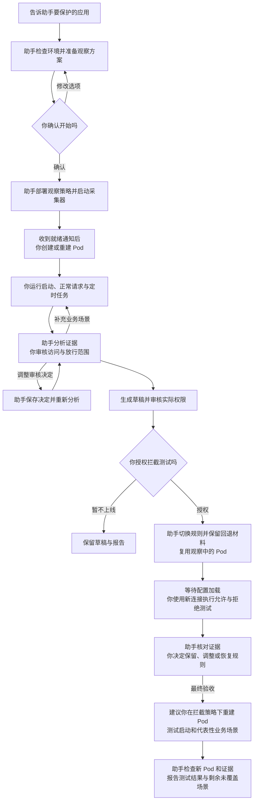
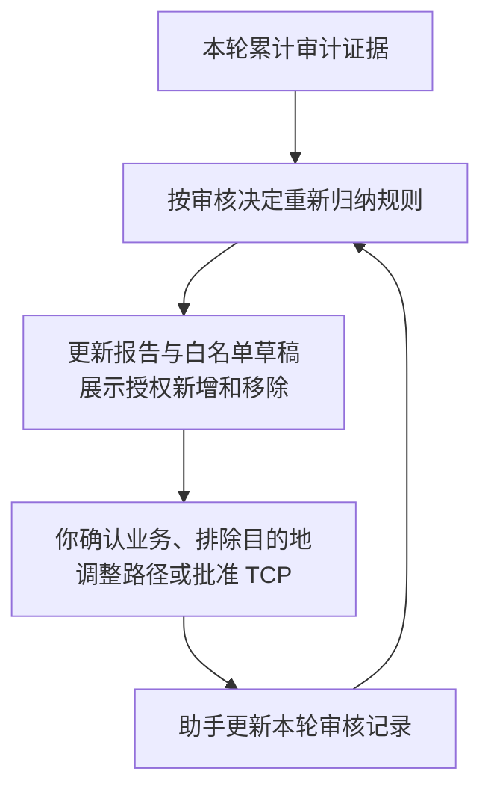
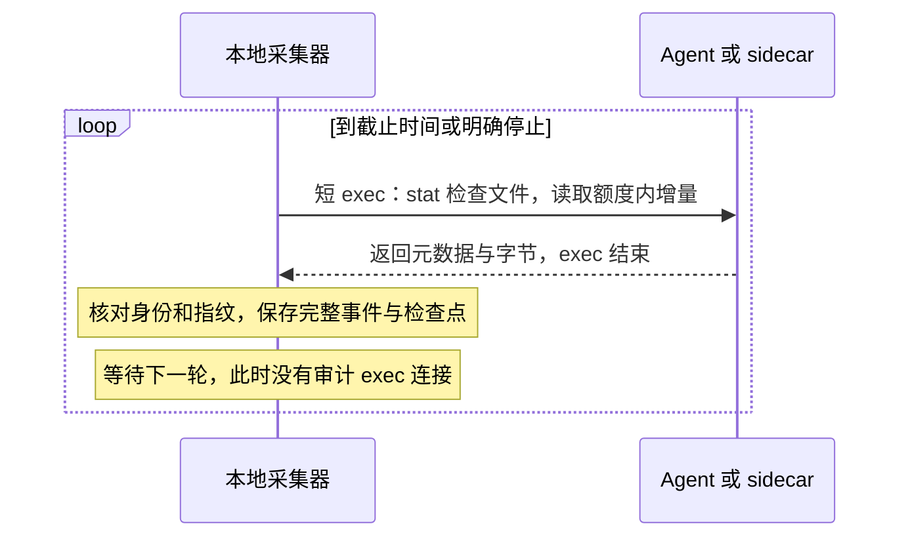
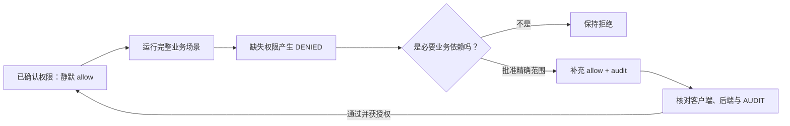
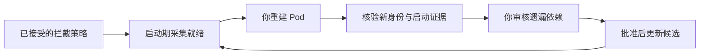

# vArmor 网络白名单助手

[English](README.md) | 简体中文

用自然语言指定 Kubernetes 应用，助手会根据真实出站访问生成 vArmor NetworkProxy 白名单。你审核访问是否属于必要业务，再测试允许和拒绝的范围。

你不需要学习策略自定义资源（Policy CRD）或脚本命令。观察时，网络层先放行并审计，已有系统防护继续保留。审核和验证完成后，助手才按你的授权切换为白名单拦截。

快速导航：

- [安装与第一次使用](#安装与第一次使用) · [目标标签](#目标标签应该放在哪里) · [审核建议](#如何审核白名单建议)
- [调整观察](#观察过程中可以修改什么) · [日志采集](#日志如何采集) · [资源限制与拒绝审核](#高频流量已确认规则静默与缺失权限补充)
- [验证与交付](#验证上线与交付) · [注意事项](#使用时需要注意)

## 你负责什么，助手负责什么

| 你 | 助手 |
|---|---|
| 指定应用、业务场景与观察时间 | 检查环境、权限、已有策略和目标匹配 |
| 确认或修改观察方案 | 准备策略草稿，授权后创建或更新 Policy |
| 修改应用标签，创建或重建 Pod，运行业务 | 先启动采集器，再检查新 Pod 的注入和审计 |
| 判断哪些访问属于必要业务 | 分析日志，解释放行范围，保存你的审核决定 |
| 复用观察中的 Pod 执行测试，决定是否拦截 | 更新白名单草稿，核对结果，授权后切换策略 |

**应用工作负载（workload）和 Pod 的生命周期由你管理。** 助手不代为创建、更新、滚动重启或删除业务应用。生成策略始终设置 `updateExistingWorkloads: false`。复用已有策略时，助手也会关闭自动更新开关，备份原对象并说明变化。



补充业务场景时，可复用本轮新 Pod。补充启动场景时，由你创建新实例。观察已结束时，需要新会话和新的观察方案。

## 开始前需要准备什么

- 能执行本地命令并访问集群的助手环境，例如 Codex 或 Claude Code。环境需有 Python 3.9+ 和 kubectl，无需额外 Python 包。
- 可用的 vArmor NetworkProxy，版本为 v0.10 及以上。助手按实际 CRD、代理、权限和日志能力检查兼容性，部署前校验策略。
- 目标集群 context、namespace、workload 名称或稳定 Pod 标签。已有 Policy 时，一并提供名称。
- 管理目标 workload 的方式，以及要覆盖的业务场景。例如启动、正常请求、定时任务、重试和不同副本。

**Policy 和 workload 都可以尚未创建。** 提供计划目标或 Pod 标签后，助手即可准备观察方案。只有 workload 时，助手新建策略；有兼容的命名空间级 Policy 时，助手调整原对象。

当前自动合并支持 `VarmorPolicy`。`VarmorClusterPolicy`、重叠策略和不兼容配置需要单独处理。

## 安装与第一次使用

### 1. 安装 Skill

解压分发包后，得到 `varmor-network-advisor/` 目录。整个目录都需要保留，包括 `SKILL.md`、`scripts/`、`references/` 和 `agents/`。

建议将整个目录复制到助手的技能目录。以下以 Codex 用户级安装为例：

1. 确认目标目录不存在。
2. 将命令中的 `/ABS/varmor-network-advisor` 换成解压目录的绝对路径。
3. 执行复制命令。

```sh
mkdir -p ~/.codex/skills
cp -R /ABS/varmor-network-advisor ~/.codex/skills/
```

其他安装位置：

| 助手 | 用户级目录 | 项目级目录 |
|---|---|---|
| Codex | `~/.codex/skills/` | `/ABS/PROJECT/.agents/skills/` |
| Claude Code | `~/.claude/skills/` | `/ABS/PROJECT/.claude/skills/` |

复制安装后，可移动或删除原解压目录。更新时，替换已安装的副本。

如果当前会话未发现 Skill，可让助手读取已安装目录中的 `SKILL.md`。请提供文件的绝对路径。

### 2. 用自然语言指定目标

下面的名称是示例，请替换成你的目标。在 Codex 中可以这样说：

> 使用 $varmor-network-advisor，帮我限制订单应用的对外访问。正常下单和查订单要能用。我不会写 vArmor YAML，请引导我先测试，再决定是否上线。

Claude Code 可使用 `/varmor-network-advisor` 发起相同请求。你也可以只要求生成模板、不部署，或者明确指定已有策略。

### 3. 确认观察方案

助手先确认目标和业务需求，完成只读检查，再准备策略草稿。方案会区分你的要求、默认建议和环境检测结果。你可以确认开始，也可以先修改：

> 改成观察 30 分钟，其他选项保持不变，请按修订方案开始。

助手先简要说明方案，并附完整计划供审核。确认后只说明变化；采集参数与额度可随时查看。

首次交互式观察建议至少 **10 分钟**。滚动重建较慢或需要多轮交接时，建议 **15 分钟**。这不是强制下限，也不保证业务覆盖完整；定时任务可能需要更长周期。

你仍可选择更短窗口。建议先准备好重建和业务请求步骤，再启动采集。

未指定项采用以下默认建议。已有策略的配置也会纳入方案，例如保留未要求删除的 HTTPS 解密（MITM）范围。

注意：观察策略会将目标 NetworkProxy 改为放行并审计。确认方案时，请核对原有网络拦截的变化。已有系统防护继续保留。

| 项目 | 默认建议与含义 |
|---|---|
| 观察窗口 | 采集器启动后最多 1 小时，可指定其他时长或明确截止时间 |
| 网络范围 | HTTP 与 TCP；新策略默认不启用 MITM |
| 日志扫描 | 每轮完成后间隔 30 秒；积压时也不快于约定下限，默认 5 秒 |
| Pod 发现 | 持续监听新 Pod，每 5 秒检查列表以恢复发现状态 |
| 每轮处理量 | 跨日志源最多处理 4 MiB 新日志内容，与返回字节计量分别约束 |
| 审计返回额度 | 每滚动 60 秒最多 16 MiB，观察与拦截证据阶段共享账本 |
| 读取并发与超时 | 最多同时读取 2 个日志源；Kubernetes 读取轮次最多 30 秒，且不超过观察剩余时间 |
| 分析 | 每 5 分钟检查新数据，有新数据才更新报告，结束时再分析 |
| 白名单粒度 | 可见 HTTP 保留精确 host、port、path 和 method；TCP 单独审核 |
| 本地容量 | 默认会话存储停止阈值 512 MiB，达到阈值停止并报告 |

等待方案确认时，尚未部署策略或启动采集。相对观察时长从采集器启动时计时，包含准备、等待重建和业务运行。绝对截止时间不会因等待而推迟。

你明确要求按已展示的完整方案开始时，助手不会重复确认。

### 4. 收到就绪通知后，再创建或重建 Pod

**收到采集器就绪通知后，再创建或重建 Pod。** 助手会说明实际截止和剩余时间，以及采集周期、日志来源和标签要求。先就绪再重建，启动期流量才有机会被收集。

交接前和你再次回复时，助手会检查采集器状态及剩余时间。就绪消息只表示检查当时可继续，不保证进程以后一直存活。

每次交接先说明当前进度、下一步由谁执行，以及成功标准。例如：

> 采集器已就绪，观察截止为 15:30。请重建应用并运行查单业务。助手会核对新 Pod 和启动证据。

`workflow-status.md` 汇总当前阶段和下一步。权限变化后，旧验证会标为过期。已保存的检查通过，不代表当前集群状态已重新核验。技术详情保留在报告链接中。

注意：交接延迟、采集失败或到期可能使消息失效。助手会先说明证据缺口，再判断下一步。超时诊断保留操作、阶段和时间限制，不能据此确定根因。

每轮新观察都排除交接前已有的 Pod UID，即使旧 Pod 已带代理。请创建或重建出新 UID；同一 Pod 内重启容器不等同于重建。完成后告诉助手：

> 我已完成目标 Pod 的创建或重建。请检查新 Pod 和代理注入。我会继续运行正常业务、重试和定时任务，请分析日志并告诉我还缺哪些场景。

新 Pod 删除后，已验证的身份和已采集的证据仍保留。尚未读取的末尾日志可能丢失。Pod Ready 本身不证明代理、审计或启动场景已验证。

## 目标标签应该放在哪里

默认 vArmor 安装要求目标对象具备启用标签，同时匹配 Policy target：

```yaml
sandbox.varmor.org/enable: "true"
```

| 策略目标 | 你需要检查或修改的位置 |
|---|---|
| Deployment / StatefulSet / DaemonSet | 对象自身的 `metadata.labels`，不能只放在 Pod template 上 |
| Pod | Pod 的 `metadata.labels` |
| 自定义 controller 管理的应用 | 使用 Pod target；在 controller 的 Pod 模板中配置稳定业务标签和启用标签 |

实际要求以集群 webhook 选择器为准，助手会说明修改位置。只给自定义 CRD 对象加标签，不一定会传递到生成的 Pod。可以这样描述：

> 应用由自定义 controller 管理。请匹配 namespace=agents 中带 app=assistant 标签的 Pod，使用 kind=Pod。我负责修改 controller 的 Pod 模板和重建 Pod。

不同控制器都由你管理 Pod 生命周期。代理注入、运行时兼容性和审计仍需实际检查。

## 如何审核白名单建议

助手先展示实际授权表和待审核事项，再提供 `candidate.yaml`。请核对：

- 目的地和端口。
- 路径（path）和请求方法（method）。
- 放行范围，以及本轮新增和移除的权限。

注意：观察到的活动不自动等于合法业务。

默认从响应为 2xx/3xx 的审计（`AUDIT`）请求归纳 HTTP 候选。上游错误响应需确认业务必要性。代理拒绝（`DENIED`）、失败连接、异常身份和缺字段记录不会自动加入白名单。

不同网络场景可得到的控制粒度不同：

| 场景 | 能生成什么 | 你需要知道什么 |
|---|---|---|
| 明文 HTTP | host、实际端口、path、method | 默认精确匹配；动态路径是否泛化由你决定 |
| 已授权 MITM 的 HTTPS | 解密后可见的 host、端口、path、method | 需要应用信任证书颁发机构（CA），并检查证书固定、双向 TLS（mTLS）的兼容性 |
| 未解密 HTTPS | TLS 服务器名称指示（SNI）、实际端口 | 无法按 path 和 method 限制透传 TLS；无 SNI 时不能推断域名 |
| 其他 TCP | 完整 IP、端口 | 单独批准后才生成规则；可能同时放行同目的地的 HTTP/TLS |

需要 HTTPS 路径控制时，可以说：

> 允许对 api.example.com 开启 MITM。我负责重建 Pod 并运行请求，请检查 CA 信任和实际路径可见性。downloads.example.com 保持 TLS 透传，只按 SNI 和端口控制。

首次启用 MITM 涉及新 Pod 或挂载。改变观察配置时，需要单独的观察会话，不能混用不同解密范围的证据。

注意：验证时保持正常证书校验。使用 `curl -k` 会掩盖证书问题。

### “保存审核决定并重新分析”是什么意思

告诉助手哪些访问必要、哪些不属于正常业务，以及希望如何匹配。助手保存本轮审核决定，再用已采集日志重新生成报告和草稿。你不需要手动编辑审核文件。



例如，初稿包含两个明文 HTTP 精确路径，一个统计域名，以及一个待审核数据库连接：

| 你的决定 | 重新分析后的变化 |
|---|---|
| “api.example.com 的 `/v1/projects/123` 和 `/v1/projects/456` 是动态 ID，新项目 ID 也要能 GET 查询，其他管理路径保持原来的精确范围” | 归纳为 `/v1/projects/` 子树；同 method 也能访问子树中的其他 ID 和路径 |
| “telemetry.example.com 不属于正常业务，请持续排除” | 不再用该域名的证据生成规则；本轮后续分析沿用这个决定 |
| “10.0.0.8:5432 是必要数据库连接，允许完整 IP/端口” | 从待审核 TCP 转为候选授权；放行范围涵盖该目的地的整个 TCP 访问 |

可以一次说明：

> 请保存以上审核决定，保留其他已有决定并重新分析。展示相对上一版新增和移除的授权，暂不应用候选。

审核记录保存在本轮会话的 `review.json`，后续分析沿用。修改或撤销决定时，直接告诉助手。审核记录只适用于本轮会话，不是所有应用的通用偏好。

重新分析使用已保存的证据，观察停止后也可执行。不需要为此重新采集或重建 Pod。未覆盖的业务仍需另行采集，并由你运行。

必要 TCP 连接即使没有审计证据，也会保留为待确认需求。你明确批准整个 IP/端口后，连接会加入同一份 `candidate.yaml`，标为“用户声明、尚未验证”。重新分析会保留决定，并区分声明与观测证据。

执行验证使用独立证据。候选策略变化后，旧验证结果会标为失效。

当前路径规则只支持精确匹配和前缀匹配。前缀不能只允许数字 ID，同时排除 details、admin 等子路径。

如果你不接受扩大范围，助手可按你的决定保留有限的精确清单。报告会说明仍无法支持的动态请求。有限清单测试通过，不代表未来任意 ID 都能访问。

**保存与重新分析只更新本地记录、报告和草稿，不自动修改线上 Policy。**

注意：排除项只过滤建模输入，不生成显式拒绝规则。其他宽泛权限仍可能放行同一目的地。批准 TCP、放宽路径或移除 method 限制前，请核对扩大后的访问范围。

## 观察过程中可以修改什么

你可以继续补业务场景、修改审核决定，也可以要求缩短、延长或停止观察。运行中调整时间时，直接说：

| 你的表达 | 处理方式 |
|---|---|
| “再观察 30 分钟” | 从本次请求起再保留 30 分钟 |
| “延长一小时” | 在当前截止时间上增加一小时 |
| “总共观察两小时” | 按原采集器启动时间计算新截止 |
| “改到今天 18:00 结束” | 明确日期和时区后调整截止 |
| “现在结束” | 请求停止采集并生成最终报告 |

明确修改请求无需重复确认。助手会检查生效回执，再说明原截止、新截止和剩余时间。

注意：时间变更在当前轮次完成后的安全点处理，可能有延迟。**请求已提交不等于已经生效。** 即使到期前提交，也可能来不及生效。

调整截止会保留证据和读取位置，不需要重建 Pod，也不会自动提高存储阈值。观察已结束或已到期时，需要新会话。助手会说明采集空档和新的交接要求。

每 5 分钟的分析由本地程序执行，模型不会因此自动发消息。需要跨会话通知时，请明确告诉助手。通知取决于宿主调度工具和本地进程是否存活。

## 日志如何采集

助手在本地运行一个有截止时间的采集器。**每轮日志读取单独使用 `kubectl exec`，返回额度内的数据后结束。** 审计 exec 连接不会保持整个观察期。

另有独立的 Pod watch，通常持续连接以发现新建和删除的 Pod。watch 可能重连；发现过程发生中断时，助手会报告风险。

| 日志来源 | 选择方式 |
|---|---|
| 现有 vArmor Agent | 普通节点默认途径，通过 Agent 容器读取节点 `/var/log/varmor/violations*.log` |
| NetworkProxy sidecar | 微虚机（micro-VM）Pod 默认途径，读取容器内的规范化审计文件 |
| 临时 reader Pod | 显式授权的快照兜底，只读挂载节点日志；尚未接入有预算的 `monitor` |
| 已保存日志 | 离线分析，不具备在线 Pod 身份或文件连续性的保证 |

`auto` 按实际 Pod 卷配置选择 Agent 或 sidecar。Agent 和代理的标准输出（stdout）用于诊断，通常不能替代规范化审计文件。

通过 SSH 或已有日志平台导出的文件可以导入分析。当前采集器不会自动连接 SSH 或日志平台。



<details>
<summary>读取位置、日志轮转与字节计量</summary>

采集器保存文件身份（设备号/inode）和完整日志行的读取偏移：

- `stat` 提供文件身份和大小。
- `dd` 定位读取，`head`/`tail` 在容器端裁剪返回内容。
- 检查点前最多重读 64 字节，核对 SHA-256 指纹。
- 正常记录只推进到完整行；末尾半行留到后续扫描。
- 检测并丢弃的异常超长行记为缺口，不作为完整证据。

重命名轮转后，保留的旧文件通常身份不变。采集器先补读旧文件尾部，再读新文件。已知未读文件消失时，报告确认的日志源缺口。文件缩小或检查点指纹变化时，报告疑似重置。

注意：这些检查不能发现所有覆盖或写入前丢弃的事件。两次扫描之间出现又删除的文件也可能漏读。日志源缺失字节，不等于确定丢失了多少目标事件。

每轮处理量限制新增日志内容。滚动字节额度则限制审计 exec 的返回量，包含元数据、分帧、指纹重叠和重读。

读取前预留额度，在容器端限制返回量，读取后保存实际用量。传输失败且无法确认用量时，按预留额保守计量。观察和拦截证据阶段共享账本。

额度不足时，采集器保留位置并报告压力，等待后续额度或到期停止。采集器不会先下载整份文件再丢弃超量内容，也不会回退到无上限快照。

</details>

你可以直接说：“告诉我当前日志来源、最后成功读取、积压和预算使用情况，保持已约定上限。”无需操作脚本。

## 高频流量、已确认规则静默与缺失权限补充

你可以这样提出要求：

> 每 30 秒扫描日志，忙时也不要快于 5 秒；最多同时读两个日志源，每分钟
> 返回的审计数据不超过 16 MiB。即便跟不上，也不要自动突破这些上限。

助手先展示资源上限，采集器按约定执行。审计返回字节包含元数据、分帧、重复读取和指纹重叠。API、watch 和传输协议开销不计入，因此这不是总网络带宽或 CPU、内存配额。

本地存储采用停止阈值，默认 512 MiB；事务和记录可能增加开销。达到上限后仍有积压时，助手会说明遗漏风险，不自动提高上限。

观察期继续放行并审计。你确认权限范围并授权拦截后，已确认规则可静默放行，即不记录正常请求。未授权行为仍被拒绝并生成 `DENIED`。

说明：静默规则使用 `allow`，不需要修改 varmor-agent。观察期的全量审计规则仍生效，追加 `allow` 不能抵消审计。



> 健康检查和订单查询的权限我确认了，正常请求不用继续记录。请把拒绝的
> 依赖整理出来，在增加权限之前让我审核。

助手复用已验证的 Pod，建立独立、有截止时间的拦截证据窗口，沿用资源上限。由你执行业务，助手按实际可见字段整理拒绝项：

- HTTP 方法和路径。
- TLS 域名和端口。
- TCP IP 和端口。

被拒绝不代表业务必需。你批准后，助手将精确补充权限加入同一份 `candidate.yaml`。批准理由和 `DENIED` 来源一并保存，其他权限不变。

新权限先开启审计以验证成功，确认后可静默。被你拒绝的调试访问或错误方法不会自动放行。

注意：前置依赖被拦截时，后续依赖可能尚未出现。补齐后需重新执行完整场景。

静默验证需要核对：

- 客户端成功和后端结果。
- 实际代理配置已加载。
- 额度内的日志读取覆盖了请求窗口。

没有审计本身不能证明成功。资源受限或日志未读完时，报告会保留“证据不足”。报告分别列出成功观察、`DENIED` 审核补充、审计开关和后续验证。回放覆盖率不代表全部业务已覆盖。

助手保存实际测试回执。程序核对输出内容、哈希、Pod 身份和时间窗口。仅填写“已确认”不能通过验证。客户端和后端证据仍需来自实际测试。

常见的普通 HTTP 和 HTTPS 透传规则可自动核对实际代理权限。MITM、TCP 放行等配置暂不支持自动证明。缺少配置证据时，静默检查保留“证据不足”。助手会说明权限和可见性限制。

决定保存在 `refinement.json`，拦截日志保存在独立目录。你不需要编辑这些文件或学习脚本命令。

### 撤销或恢复已经允许的访问

<!-- stc-disable-next-line: 保留用户示例原文。 -->
> 刷新接口已经停用了。请撤销之前允许它的权限，其他请求继续正常工作。

助手移除对应的候选规则，保存撤销理由和原批准记录。重新分析不会恢复这条权限，也不需要等待新的 `DENIED`。此前的静默批准一并清除。

恢复访问需要你明确授权。恢复的规则先开启审计并重新验证，再决定是否静默。

注意：移除一条规则后，其他前缀、域名或 TCP 权限可能仍放行同一目的地。报告会列出可能重叠的权限。助手核对实际配置，再由你用新连接测试。

“不再用这个域名的日志生成建议”只排除建模输入，不等于“撤销已有权限”。撤销全部可用权限时，会生成明确标记的全拒绝候选。助手先解释影响，应用前仍需你的部署授权。

观察期和拦截期的报告都使用你选择的语言。可随时要求“报告改成中文”或“后续用英文”。后续分析沿用该选择，无需重启采集器或修改 Policy。

### 迭代时保留明确的禁止要求

> 即使以后放宽正常业务规则，也要一直禁止 debug 接口。

助手先解释实际拒绝范围，再单独保存你批准的规则。重新分析、切换语言、静默放行或撤销其他权限，都不会移除拒绝规则。删除拒绝规则需要单独明确批准。报告会列出放行和拒绝规则的增删。

手工修改的候选文件会保留。助手先核对并保存审核决定，再重新生成。

明文 HTTP 或 MITM 可以按路径和方法拒绝访问。未解密的 TLS 看不到这些字段。

警告：同一条 HTTP 拒绝规则还会禁止匹配的整个 SNI/端口。当前接口没有“只作用于 HTTP”的开关。助手必须在批准前解释影响，不能承诺接口无法表达的协议隔离。

拒绝放行建议或撤销权限，本身都不会生成显式拒绝规则。

## 验证、上线与交付

白名单草稿默认拒绝未授权访问，但生成草稿本身不会开启拦截。你可以先要求：

> 给我本轮实际授权、待审核 TCP、采集缺口和未覆盖场景，再提供候选策略及允许/拒绝测试要求。暂不上线。

调整白名单、切换拦截或恢复观察时，通常可复用本轮已注入代理的 Pod。助手等待配置加载并核对实际行为，再由你使用新连接测试。

注意：未注入代理，或需要新增挂载、环境变量、重定向设置时，可能需要创建或重建 Pod。首次启用 MITM 也需检查这些条件。

最终验收时，助手建议在已接受的拦截策略下重建 Pod。重建可消除观察阶段旧连接的影响，检查遗漏的启动依赖。由你测试启动、正常业务、重新连接和代表性定时任务。助手检查新 Pod 和证据；测试通过也不代表所有业务场景已覆盖。

助手在你重建**之前**启动独立、有截止时间的启动期采集。采集器排除旧 Pod，并核对新目标 Pod 的身份。应用因拦截无法 Ready 时，也能审核已验证身份的 `DENIED` 事件。身份无法核验或日志无法读取时，报告会说明缺口。

你批准遗漏的启动依赖后，助手更新候选并准备新的启动期采集。收到就绪通知后，再由你重建 Pod 验证。原观察数据和资源上限不会被替换。



由你执行请求，助手核对客户端结果、后端记录和网络审计。验证场景包括：

- 正常业务。
- 错误 method 和邻近路径。
- 未知 Host/SNI。
- 必要 TCP 连接和 MITM 请求。

注意：Policy Ready 或服务器校验通过，不能替代真实请求验证。

确认业务覆盖和测试结果后，再明确授权助手切换目标策略。助手会保留当前策略备份及观察规则回退材料，始终保持 `updateExistingWorkloads: false`。

**停止采集不会改变已部署的 Policy。** 停止观察后仍放行并审计；停止拦截期采集后仍拦截。到期不会自动切换模式、移除代理或删除应用。

警告：恢复原策略前，需要核对自动更新开关。移除首次注入的代理或 MITM 挂载，需要由你重建 Pod。

| 主要产物 | 用途 |
|---|---|
| `report.md` | 实际授权表、授权增删、待审核 TCP、未覆盖行为与下一步 |
| `workflow-status.md` / `workflow-status.json` | 当前阶段、下一执行者、下一步及证据入口；不证明当前线上状态 |
| `candidate.yaml` | 待审核白名单草稿；没有可接纳规则时不生成 |
| `review.json` | 本轮保存的业务审核决定，后续分析沿用 |
| `refinement.json` | DENIED 审核、静默、权限撤销/恢复及显式拒绝约束，保留理由、历史和批准证据 |
| `resource-usage.json` | 观察与拦截证据阶段共享的滚动审计字节账本 |
| `collector.json` | 实际计划、就绪与采集状态、时间调整回执、缺口和停止原因 |
| `observe.yaml` / `validation.yaml` | 放行审计策略及验证、回退材料 |
| `original-policy.json` | 复用已有策略时保存的原对象 |
| 独立的 `verification.md` / `verification.json` / `denials.json` | 验证清单、策略和 Pod 身份、时间窗口、核对结果与拒绝审核项 |
| `analysis.json` / `events.sqlite` | 结构化分析结果及累计审计证据 |

### 便于阅读的策略文件

`candidate.yaml`、`observe.yaml` 和 `validation.yaml` 使用缩进 YAML。会话状态、分析结果和审核记录使用 JSON。无需额外 Python 包，也兼容旧版 JSON 格式的策略文件。

导入已有 Policy 时，使用 Kubernetes 的 JSON 导出。内置读取器只支持生成的 YAML 格式，不支持任意 YAML 语法。

## 使用时需要注意

- **覆盖率只描述已有证据。** 回放覆盖 100%、候选稳定或没有新流量，不代表低频任务、重试、故障切换和所有副本已经覆盖；上线前仍需真实验证。
- **日志可能有缺口。** 已知未读字节消失时，报告确认的日志源缺口。读取中断或文件重置时，报告疑似缺口。共享节点日志缺失，不一定能确定目标丢了多少事件。写入前的丢弃可能无法感知。“未检测到缺口”不保证日志完整。
- **保持采集环境运行。** 机器休眠、重启或宿主工具退出可能中断观察。尚未到期的恢复沿用最新已生效截止，报告中断风险，不自动续期。微虚机的末尾日志可能随 sidecar 删除而消失。
- **中断时间不算观察。** 恢复后已到截止时，采集器不会开始新的读取。检测到时钟跳变或长时间无心跳时，会标记疑似缺口，并从运行时长中排除该区间。运行时长不代表业务覆盖完整。
- **容量阈值不是硬磁盘配额。** 默认 512 MiB 在轮次间检查，当前批次和最终报告仍可能超过阈值；不会删除旧证据腾空间。规模较大时宜使用已有持久化日志后端。
- **留意权限范围。** 新 Pod 尚未调度时，助手先检查指定 Agent 范围内的节点日志，不能扩大授权。持续采集需要日志容器支持 sh、stat、dd、head 和 tail。工具不足时，先诊断或约定替代方案，不能绕过资源上限读取在线快照。离线输入的连续性能力不同。兜底读取需要镜像时，请提供当前环境可拉取的镜像。
- **了解网络边界。** 这份白名单不能证明已覆盖 UDP/DNS、QUIC、loopback 或绕过 TCP 重定向的流量。网络审计只区分 Pod，不能区分同 Pod 内的应用容器或进程。观察结束时仍未关闭的长连接，可能尚未产生审计。必要连接未出现在报告中时，请告诉助手；没有记录不代表业务不需要该连接。
- **保护本地文件。** 会话使用私有目录，入库前去除路径 query，但路径和其他保留字段仍可能敏感。分享报告前核对其中的业务信息。

## 常见问题

| 问题 | 可以怎样告诉助手 |
|---|---|
| 有 kubectl，但没有审计 | “请检查代理注入、审计规则、日志来源和读取权限，说明阻塞证据。” |
| Pod 未注入代理 | “请检查 Policy target、启用标签位置和 webhook 选择器，告诉我需要修改哪里。” |
| Agent 自动发现失败 | 提供 vArmor 安装 namespace、Agent 标签或容器名，让助手核对读取位置 |
| HTTPS 有流量却看不到 path | “请说明当前是否透传，评估对必要域名开启 MITM 的兼容性。” |
| HTTP 403 没加入候选 | “请区分上游业务错误与代理拒绝。” 必需的上游错误可经审核接纳，代理拒绝不自动放行 |
| 没有生成 candidate.yaml | “请解释是空数据、排除项还是不可接纳字段，并给出补充场景。” 不使用旧候选冒充当前建议 |
| 发现采集缺口 | “请说明检测窗口、日志源和不确定影响，我来补跑对应场景。” |
| 采集器提前停止 | “请核对截止时间、进程、权限与存储阈值，说明能否恢复或需要新会话。” |
| 切换白名单后想继续分析拒绝 | “请单独处理上线后的拒绝审计。” 原观察会话固定观察配置，不混合不同模式或自动补白名单 |

以下英文参考文档供助手处理规则语义和排障细节，日常使用无需阅读：

- [网络授权边界](references/networkproxy.md)。
- [观察与采集连续性](references/observation-and-collection.md)。
- [审核决定与通知调度](references/review-and-scheduling.md)。
- [独立执行验证](references/verification.md)。

<!-- package:source-only:start -->
## 维护者说明

<details>
<summary>开发安装、打包分发与回归验证</summary>

### 从源码开发安装

从仓库持续更新 Skill 时，可用安装脚本创建符号链接。源文件修改会立即反映到安装位置。在此目录执行：

```sh
# 安装到指定项目；已存在其他安装时会拒绝覆盖。
python3 install.py --tool codex --project /ABS/PROJECT

# 用户级安装到 Codex 与 Claude Code。
python3 install.py --tool both
```

安装脚本只创建相对符号链接，不检测或安装助手和依赖。

注意：单独移动源目录会使链接失效。移动后，需核对并移除旧链接，再从新位置安装。源目录和链接一起移动、相对位置不变时，链接仍可用。不要提交指向本机绝对路径的链接。

### 打包分发

打包只需 Python 3.9+，不访问集群。可在此目录执行，也可从任意目录指定 `package.py` 路径。输入始终从脚本所在目录读取。

```sh
# 普通用户精简包：运行文件与中英文使用说明，共 14 个文件。
python3 package.py

# 完整包：额外包含安装、打包及回归工具。
python3 package.py --full

# 指定输出位置。
python3 package.py --output /ABS/RELEASE/varmor-network-advisor-skill.zip
```

默认分别输出 `dist/varmor-network-advisor-skill.zip` 和 `dist/varmor-network-advisor-full.zip`。两种包解压后都得到 `varmor-network-advisor/` 目录，可按用户指南复制安装；完整包还能使用开发安装脚本。

打包按明确文件清单收集资源：

- 不包含 `evidence/`、本地 session、缓存、旧 ZIP 或清单外文件。
- 新增运行资源或测试时，需要更新清单。
- 两种包都包含中英文 README；`SKILL.md` 和 `references/` 为英文。
- 精简包的 README 自动省略“维护者说明”。
- 同一 Python/zlib 环境中，相同输入得到相同字节；成功后才替换旧输出。
- 生成的 ZIP 和 `dist/` 不提交仓库，可作为 Release 附件。

### 回归验证

```sh
PYTHONDONTWRITEBYTECODE=1 python3 -m unittest discover -s tests -v
python3 tests/smoke_cluster.py --context CONTEXT --image APPROVED_CURL_IMAGE --output /ABS/NEW_HTTP_RESULT
python3 tests/smoke_tls_tcp.py --context CONTEXT --image APPROVED_CURL_IMAGE --output /ABS/NEW_TLS_RESULT
python3 tests/smoke_collector.py --context CONTEXT --image APPROVED_CURL_IMAGE --output /ABS/NEW_COLLECTOR_RESULT
```

在线测试创建独立 namespace 和自有资源，完成后删除。通过 `--image` 提供可拉取的 curl 镜像，需包含 sh、cat 和 BusyBox nc。

HTTPS 测试额外使用集群已有的 Envoy 镜像，本地需 openssl。测试仅读取自建策略的临时 CA，用于签发自有后端证书。私钥不写入验证记录，客户端始终校验证书。

这些工具用于维护者回归，不代替用户管理业务 workload。持续采集器由助手按观察授权启动。分发包不会自行创建原生通知调度任务。

</details>
<!-- package:source-only:end -->
