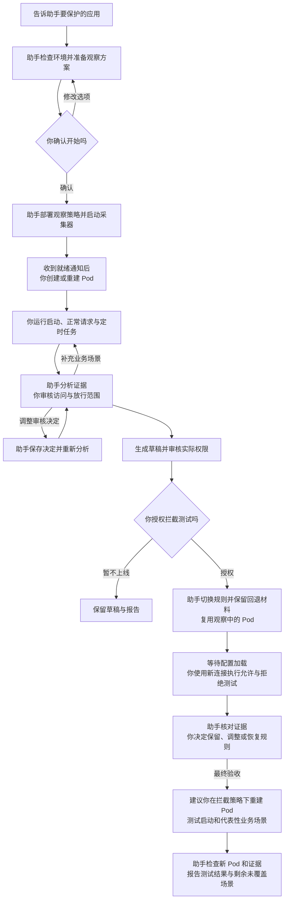
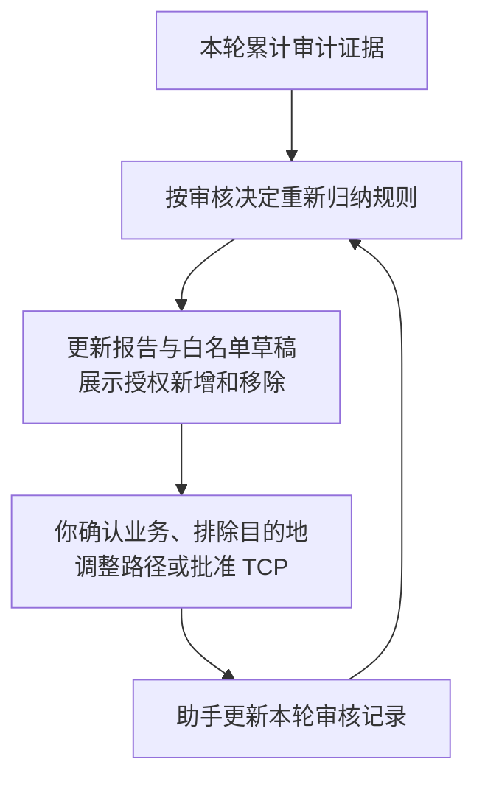
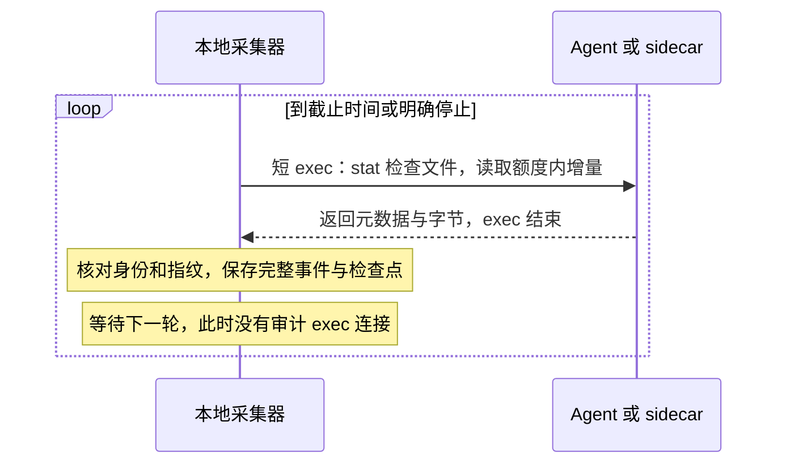
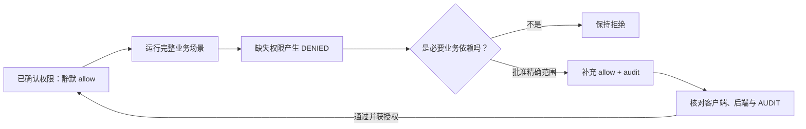
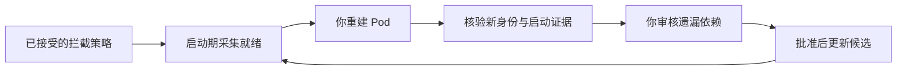

# vArmor 网络白名单助手

[English](README.md) | 简体中文

用自然语言告诉助手要保护哪个 Kubernetes 应用。助手会先收集真实出站访问，再和你一起审核业务需求，生成可解释、可验证的 vArmor NetworkProxy 白名单。

你不需要学习 Policy CRD 或内置脚本的命令。已有的系统层防护会保留；网络层先放行并审计，审核和验证完成后，才在你授权时切换到默认拒绝的白名单。

从这里开始：[安装与第一次使用](#安装与第一次使用) · [目标标签](#目标标签应该放在哪里) · [审核建议](#如何审核白名单建议) · [调整观察](#观察过程中可以修改什么) · [日志与资源限制](#日志如何采集) · [静默与拒绝审核](#高频流量已确认规则静默与缺失权限补充) · [验证与交付](#验证上线与交付) · [注意事项](#使用时需要注意)

## 你负责什么，助手负责什么

| 你 | 助手 |
|---|---|
| 指定应用、业务场景与观察时间 | 检查环境、权限、已有策略和目标匹配 |
| 确认或修改观察方案 | 准备策略草稿，授权后创建或更新 Policy |
| 修改应用标签，创建或重建 Pod，运行业务 | 先启动采集器，再检查新 Pod 的注入和审计 |
| 判断哪些访问属于必要业务 | 分析日志，解释放行范围，保存你的审核决定 |
| 复用观察中的 Pod 执行测试，决定是否拦截 | 更新白名单草稿，核对结果，授权后切换策略 |

**应用 workload/Pod 的生命周期由你管理。** 助手不代为创建、更新、滚动重启或删除业务 workload。生成策略始终设置 `updateExistingWorkloads: false`；复用已有策略时也关闭原有自动更新开关，并保留原对象备份、说明变化。



补充场景时可继续在本轮新 Pod 上运行业务，不必每次重建；需要补启动场景时由你管理新实例。观察已经结束时，另开会话并重新确认计划。

## 开始前需要准备什么

- 可执行本地命令并访问目标集群的助手环境，例如 Codex 或 Claude Code；该环境有 Python 3.9+ 和 kubectl，无需安装额外 Python 包。
- 可用的 vArmor NetworkProxy。这个 Skill 面向 vArmor v0.10 及以上版本；助手会检查实际 CRD、代理、权限与日志能力。后续版本按实际接口能力判断兼容性，并在部署前校验策略。
- 目标集群 context、namespace、workload 名称或稳定 Pod 标签；已有 Policy 时一并提供名称。
- 可以管理目标 workload 的方式，以及要覆盖的业务场景，例如启动、正常请求、定时任务、重试和不同副本。

**Policy 和 workload 都可以尚未创建。** 只要能说明计划目标或 Pod 标签，助手就能准备观察方案。只有 workload 时新建策略；有兼容的 namespaced Policy 时基于原对象调整。当前自动合并支持 `VarmorPolicy`；`VarmorClusterPolicy`、重叠策略或不兼容配置需要单独处理。

## 安装与第一次使用

### 1. 安装 Skill

解压分发包后，得到 `varmor-network-advisor/` 目录。整个目录都需要保留，包括 `SKILL.md`、`scripts/`、`references/` 和 `agents/`。

建议把目录复制到助手的技能目录。以下以 Codex 用户级安装为例；将 `/ABS/varmor-network-advisor` 替换成解压目录的绝对路径，先确认目标目录不存在：

```sh
mkdir -p ~/.codex/skills
cp -R /ABS/varmor-network-advisor ~/.codex/skills/
```

其他安装位置：

| 助手 | 用户级目录 | 项目级目录 |
|---|---|---|
| Codex | `~/.codex/skills/` | `/ABS/PROJECT/.agents/skills/` |
| Claude Code | `~/.claude/skills/` | `/ABS/PROJECT/.claude/skills/` |

复制安装后，可以移动或删除原解压目录；更新时替换已安装的副本。如果当前会话还未发现 Skill，可以让助手读取已安装目录下 `SKILL.md` 的绝对路径。

### 2. 用自然语言指定目标

下面的名称是示例，请替换成你的目标。在 Codex 中可以这样说：

> 使用 $varmor-network-advisor，帮我限制订单应用的对外访问。正常下单和查订单要能用。我不会写 vArmor YAML，请引导我先测试，再决定是否上线。

Claude Code 可使用 `/varmor-network-advisor` 发起相同请求。你也可以只要求生成模板、不部署，或者明确指定已有策略。

### 3. 确认观察方案

你不需要知道观察模式、路径深度或采集命令。助手会先问清目标与业务需求，再完成只读检查并准备策略草稿，展示最终建议，标明哪些来自你的要求、哪些采用默认值、哪些是环境检测结果。你可以确认开始，也可以先修改：

> 改成观察 30 分钟，其他选项保持不变，请按修订方案开始。

未指定项的默认建议如下。已有策略的真实配置也会纳入方案，例如原有 MITM 范围不会仅因你没提及就被删除。

观察策略会将目标 NetworkProxy 的网络层改为放行并审计。已有网络拦截范围的变化需在确认方案时核对；已有系统防护继续保留。

| 项目 | 默认建议与含义 |
|---|---|
| 观察窗口 | 采集器启动后最多 1 小时，可指定其他时长或明确截止时间 |
| 网络范围 | HTTP 与 TCP；新策略默认不启用 MITM |
| 日志扫描 | 每轮完成后间隔 30 秒；积压时也不快于约定下限，默认 5 秒 |
| Pod 发现 | 持续监听新 Pod，每 5 秒进行列表恢复检查 |
| 每轮处理量 | 跨日志源最多处理 4 MiB 新日志内容，与返回字节计量分别约束 |
| 审计返回额度 | 每滚动 60 秒最多 16 MiB，观察与拦截证据阶段共享账本 |
| 读取并发与超时 | 最多同时读取两个日志源；Kubernetes 读取轮次最多 30 秒，并受观察剩余时间约束 |
| 分析 | 每 5 分钟检查新数据，有新数据才更新报告，结束时再分析 |
| 白名单粒度 | 可见 HTTP 保留精确 host、port、path 和 method；TCP 单独审核 |
| 本地容量 | 默认会话存储停止阈值 512 MiB，达到阈值停止并报告 |

等待方案确认时尚未部署和采集，相对时长不开始计时。确认后的采集器准备、等待你重建 Pod 和业务运行都计入已启动窗口。绝对截止时间不会因等待而推迟。你明确要求采用已展示的完整方案直接开始时，助手不会重复确认。

### 4. 收到就绪通知后，再创建或重建 Pod

助手会同步实际截止与剩余时间、采集和分析周期、日志源就绪范围及标签要求。**收到采集器就绪通知后再操作应用**，这样启动期流量才有机会被收集。

无论已有 Pod 是否已经带代理，本轮都排除交接前已有的 Pod UID。请创建或重建出新 UID；同一个 Pod 内重启容器不等同于重建 Pod。完成后告诉助手：

> 我已完成目标 Pod 的创建或重建。请检查新 Pod 和代理注入。我会继续运行正常业务、重试和定时任务，请分析日志并告诉我还缺哪些场景。

新 Pod 删除后，已验证身份和已采集证据仍保留，但不能保证来不及读取的末尾日志也已保存。Pod Ready 本身不证明代理、审计或启动场景已经验证。

## 目标标签应该放在哪里

默认 vArmor 安装要求目标对象具备启用标签，同时匹配 Policy target：

```yaml
sandbox.varmor.org/enable: "true"
```

| 策略目标 | 你需要检查或修改的位置 |
|---|---|
| Deployment / StatefulSet / DaemonSet | 对象自身的 `metadata.labels`，不能只放在 Pod template 上 |
| Pod | Pod 的 `metadata.labels` |
| 自定义 controller 管理的应用 | 使用 Pod target；在 controller 的 Pod 模板中配置稳定业务标签和启用标签 |

实际要求以集群 webhook 选择器为准，助手会说明需要你改哪里。只给自定义 CRD 对象加标签，不一定传递给它生成的 Pod。可以这样描述：

> 应用由自定义 controller 管理。请匹配 namespace=agents 中带 app=assistant 标签的 Pod，使用 kind=Pod。我负责修改 controller 的 Pod 模板和重建 Pod。

这套生命周期流程适用于不同控制器，但代理注入、runtime 兼容性和审计仍需实际检查。

## 如何审核白名单建议

助手先给实际授权表和待审核事项，再给 `candidate.yaml`。请关注目的地、端口、path、method、授权范围，以及本轮新增和移除的授权；观察到的活动不自动等于合法业务。

默认以正常的 2xx/3xx `AUDIT` 请求归纳 HTTP 候选。上游错误响应需确认业务必要性，代理 `DENIED`、失败连接、异常身份和缺字段不会自动加入白名单。

不同网络场景可得到的控制粒度不同：

| 场景 | 能生成什么 | 你需要知道什么 |
|---|---|---|
| 明文 HTTP | host、实际端口、path、method | 默认精确匹配；动态路径是否泛化由你决定 |
| 已授权 MITM 的 HTTPS | 解密后可见的 host、端口、path、method | 需要应用信任 CA，并检查证书固定、mTLS 等兼容性 |
| 未解密 HTTPS | SNI、实际端口 | path 和 method 不能限制透传 TLS；无 SNI 时不能推断域名 |
| 其他 TCP | 完整 IP、端口 | 单独批准后才生成规则；可能同时放行同目的地的 HTTP/TLS |

需要 HTTPS 路径控制时，可以说：

> 允许对 api.example.com 开启 MITM。我负责重建 Pod 并运行请求，请检查 CA 信任和实际路径可见性。downloads.example.com 保持 TLS 透传，只按 SNI 和端口控制。

首次启用 MITM 涉及新 Pod 或挂载；改变观察配置时需单独安排观察会话，不能把不同解密范围混入同一轮证据。验证保持正常证书校验，不用 `curl -k` 掩盖问题。

### “保存审核决定并重新分析”是什么意思

你用自然语言告诉助手哪些访问必要、哪些不属于正常业务，以及希望如何匹配。助手把这些决定保存为**本轮会话的审核记录**，然后结合已采集日志重新生成报告和白名单草稿。你不需要手动编辑审核文件。



例如，初稿包含两个明文 HTTP 精确路径，一个统计域名，以及一个待审核数据库连接：

| 你的决定 | 重新分析后的变化 |
|---|---|
| “api.example.com 的 `/v1/projects/123` 和 `/v1/projects/456` 是动态 ID，新项目 ID 也要能 GET 查询，其他管理路径保持原来的精确范围” | 归纳为 `/v1/projects/` 子树；解释它也允许同 method 访问子树中的其他 ID 和路径 |
| “telemetry.example.com 不属于正常业务，请持续排除” | 不再用该域名的证据生成规则；本轮后续分析沿用这个决定 |
| “10.0.0.8:5432 是必要数据库连接，允许完整 IP/端口” | 从待审核 TCP 转为候选授权；提醒它允许该目的地的整个 TCP 访问 |

可以一次说明：

> 请保存以上审核决定，保留其他已有决定并重新分析。展示相对上一版新增和移除的授权，暂不应用候选。

审核记录保存在会话目录的 `review.json`，本轮后续分析沿用；想修改或撤销时直接告诉助手。重新分析使用本轮已保存证据，观察停止后也可以进行，不需要为此重新采集或重建 Pod。它不是跨所有应用通用的偏好；用户声明的连接会与已观测证据明确区分；未覆盖的业务仍需安排采集并由你运行。

用户提到的必要 TCP 连接即使没有审计证据，也会保留为待确认需求。明确批准整个 IP/端口后，它会进入同一份 candidate.yaml，标明“用户声明、尚未验证”。重新分析会保留决定。执行验证使用独立证据；候选策略变化后，旧结果会标为失效。

当前路径规则只支持精确匹配和前缀匹配。前缀无法实现“只允许数字 ID，同时排除 details、admin 等其他子路径”。如果你不接受扩大范围，助手会在你同意后保留有限的精确清单，并明确哪些动态请求仍无法支持。有限清单测试通过，不代表它适合任意未来 ID。

**保存与重新分析只更新本地审核记录、报告和草稿，不自动修改线上 Policy。** 排除项用于过滤建模输入，不生成显式 deny；其他宽泛授权仍可能放行该目的地。批准 TCP、放宽路径或去掉 method 限制时，请核对实际扩大了多少权限。

## 观察过程中可以修改什么

你可以继续补业务场景、修改审核决定，也可以要求缩短、延长或停止观察。运行中调整时间时，直接说：

| 你的表达 | 处理方式 |
|---|---|
| “再观察 30 分钟” | 从本次请求起再保留 30 分钟 |
| “延长一小时” | 在当前截止时间上增加一小时 |
| “总共观察两小时” | 按原采集器启动时间计算新截止 |
| “改到今天 18:00 结束” | 明确日期和时区后调整截止 |
| “现在结束” | 请求停止采集并生成最终报告 |

明确修改请求无需重复确认。助手提交后会核对生效回执，再同步原截止、新截止和实际剩余时间。变更在当前轮次完成后的安全点处理，可能有延迟；**请求已提交不等于已经生效**，到期前提交也可能来不及生效。

调整截止保留已有证据和读取位置，不需要为此重建 Pod；不会自动提高存储阈值。已结束或已到期的观察需要新会话，助手会说明空档和新的交接要求。

每 5 分钟分析由本地程序执行，不代表模型每 5 分钟自动发消息。如果希望跨会话通知，请明确告诉助手；通知能力依赖宿主提供的调度工具和本地进程存活条件。

## 日志如何采集

助手在本地运行一个有截止时间的采集器。**每轮日志读取使用短生命周期的 `kubectl exec`，返回有界数据后结束，不会在整个观察期保持同一条审计 exec 连接。** 另有独立的 Pod watch 通常持续连接，用于发现新建和删除的 Pod；它可能重连，发现过程发生中断时会报告风险。

| 日志来源 | 选择方式 |
|---|---|
| 现有 vArmor Agent | 普通节点默认途径，通过 Agent 容器读取节点 `/var/log/varmor/violations*.log` |
| NetworkProxy sidecar | 微虚机 Pod 默认途径，读取容器内的规范化审计文件 |
| 临时 reader Pod | 显式授权的快照兜底，只读挂载节点日志；尚未接入有预算的 `monitor` |
| 已保存日志 | 离线分析，不具备在线 Pod 身份或文件连续性的保证 |

`auto` 根据实际 Pod 卷配置选择 Agent 或 sidecar。Agent/代理 stdout 用于诊断，通常不能代替规范化审计文件。SSH 或已有日志平台可以提供文件供导入，当前没有自动连接它们的采集实现。



采集器记住文件身份（设备号/inode）和已处理完整日志行的偏移。`stat` 提供身份及大小，`dd` 定位读取，`head`/`tail` 在容器端裁剪返回内容。每个检查点前最多重读 64 字节，核对 SHA-256 指纹。正常记录只推进到以换行符结尾的完整行；末尾半行留到后续扫描。采集器检测并丢弃的异常超长行会记录为缺口，不会默认为完整证据。

重命名轮转时，保留的旧文件通常身份不变，先补读其尾部，再读新的活动文件。已知未读文件消失时，报告确认的日志源缺口；文件缩小或检查点指纹变化时，报告疑似重置。这些检查不能发现所有覆盖、两次扫描之间出现又删除的文件，或写入前丢弃的事件；源文件缺失字节也不等于确定丢失了多少目标事件。

每轮处理预算限制新增日志内容；滚动额度另行限制审计 exec 返回的 stdout，包含文件元数据、分帧、指纹重叠和重读。读取前预留额度，在容器端限制返回量，读取后持久化结算；失败时无法确认的传输按预留额保守计费。不同证据阶段共享账本。额度不足时保留位置、报告压力，等待后续额度或到点停止；不会下载整个文件后再丢弃超量内容，也不会绕过预算退回无上限快照。

你可以直接说：“告诉我当前日志来源、最后成功读取、积压和预算使用情况，保持已约定上限。”无需操作脚本。

## 高频流量、已确认规则静默与缺失权限补充

你可以这样提出要求：

> 每30秒扫描日志，忙时也不要快于5秒；最多同时读两个日志源，每分钟
> 返回的审计数据不超过16 MiB。即便跟不上，也不要自动突破这些上限。

助手会先展示实际预算。采集器执行最低间隔、滚动字节额度、读取并发和
Kubernetes读取轮次的时间上限。文件元数据、分帧、重复读取和指纹重叠计入字节
额度；API、watch和传输协议开销不在这个计数中，因此不是整个网络带宽、
CPU或内存占用的硬配额。本地存储是停止阈值，默认512 MiB，可能有事务和
记录开销。达到预算后仍有积压，会告知遗漏风险，不自动提高上限。

观察期继续允许并审计。你确认权限范围并授权拦截后，已经确认的正常规则
可以静默放行，未授权行为被拒绝并生成DENIED。无需改变varmor-agent的日志
机制；在全量观察审计规则旁追加allow，不能抵消它的审计。



> 健康检查和订单查询的权限我确认了，正常请求不用继续记录。请把拒绝的
> 依赖整理出来，在增加权限之前让我审核。

助手复用现有已验证Pod，建立独立、有截止时间的拦截证据窗口，沿用预算；
你执行业务。助手按真实可见粒度整理拒绝项：HTTP方法/路径、TLS域名/端口
或TCP IP/端口。被拒绝不代表业务必需。你批准后，最小补充权限加入同一份
candidate.yaml，保留批准理由与DENIED来源，其他权限不变。新权限先记录
审计以验证成功，确认后可静默；你拒绝的调试访问或错误方法不会自动放行。
如果前置依赖被拦住，后续依赖可能还未出现，补齐后应重新执行完整场景。

静默验证需要客户端成功、后端结果、实际代理配置加载与覆盖请求窗口的
有界读取；没有审计本身不能证明成功。资源受限或未读完会保留证据不足。
报告区分成功观察、DENIED审核补充、审计开关与后续验证；回放覆盖率不代表
全业务覆盖。首次启动观察和最终启动验收仍由你重建Pod，每次调整规则不
需要重建。

决定保存在refinement.json，拦截日志在独立目录；你不需要编辑这些文件或
学习脚本命令。

### 撤销或恢复已经允许的访问

> 刷新接口已经停用了。请撤销之前允许它的权限，其他请求继续正常工作。

助手会移除对应的候选规则，保存撤销理由和原批准记录。重新分析不会把
同一条权限加回来，也不需要等待新的 DENIED。此前的静默批准一并清除；
恢复访问需要你明确授权，恢复的规则先开启审计并重新验证，再决定是否静默。

移除一条规则不等于目标已被禁止：其他前缀、域名或 TCP 权限可能仍然放行。
报告会列出可能重叠的权限，助手需要核对实际配置，并让你用新连接测试。
“不再用这个域名的日志生成建议”只是排除建模输入，和“撤销已有权限”不同。
如果你撤销全部可用权限，会得到明确标记的全拒绝候选；助手先解释影响，
应用前仍需你的部署授权。

观察期和拦截期的报告都跟随你的语言选择。你可以随时要求“报告改成中文”
或“后续用英文”，后续分析沿用该选择，不需要重启采集器或改变 Policy。

### 迭代时保留明确的禁止要求

> 即使以后放宽正常业务规则，也要一直禁止 debug 接口。

助手先解释实际范围，再将你批准的拒绝规则单独保存。重新分析、切换报告
语言、静默正常放行规则、撤销其他权限，都不会移除它。删除拒绝规则需要
单独明确批准，报告会同时列出放行和拒绝规则的增删。手工修改的候选文件
会被保留，助手需要先核对并保存审核决定，再重新生成。

明文 HTTP 或 MITM 可以按路径、方法拒绝访问；未经解密的 TLS 看不到这些
字段，因此同一条 HTTP 拒绝规则还会禁止匹配的整个 SNI/端口。当前策略
接口没有“只作用于 HTTP”的开关，助手必须在批准前解释这个影响，不能
承诺接口无法表达的协议隔离。拒绝一个放行建议、撤销一条权限，本身都
不会生成显式拒绝规则。

## 验证、上线与交付

白名单草稿默认拒绝未授权访问，但生成草稿本身不会开启拦截。你可以先要求：

> 给我本轮实际授权、待审核 TCP、采集缺口和未覆盖场景，再提供候选策略及允许/拒绝测试要求。暂不上线。

迭代拦截规则时，可以直接复用本轮观察中已注入代理的 Pod。调整白名单、切换拦截、恢复观察通常不需要再次重启或重建。助手会等待配置更新生效并核对实际行为，你使用新连接执行请求。尚未注入代理、或者变更需要新增 Pod 挂载/环境或重定向设置（如首次开启 MITM）时，可能需要由你创建或重建 Pod。

最终验收时，助手会建议你在已接受的拦截策略下重建目标 Pod，再测试启动、正常业务、重新连接和代表性定时任务。这样可以消除观察阶段旧连接的影响，并发现白名单遗漏的启动依赖。重建和请求由你执行，助手负责检查新 Pod 与证据；不要求每次调整规则都重建，测试通过也不代表所有业务场景已覆盖。

助手会在你重建**之前**启动独立、有截止时间的启动期采集，并明确告诉你
采集器已就绪。它排除旧 Pod，核验新目标 Pod 的身份；应用因拦截无法 Ready，
也能审核其 DENIED 事件。无法核验身份、无法读取日志等情况会作为缺口报告。
你批准遗漏的启动依赖后，助手更新候选，再准备新一轮启动期采集，让你
重新创建 Pod 验证。原观察数据和资源预算不会被替换。



由你执行请求，助手核对客户端结果、后端记录与网络审计。验证应覆盖正常业务，以及错误 method、邻近路径、未知 Host/SNI 和必要的 TCP、MITM 场景；Policy Ready 或服务器校验通过不能替代真实请求验证。

确认业务覆盖和测试结果后，再明确授权助手切换目标策略。助手会保留当前策略备份及观察规则回退材料，始终保持 `updateExistingWorkloads: false`。

**停止任何采集窗口都不会改变已部署的 Policy。** 停止观察仍保留放行审计，停止拦截期采集仍继续拦截；不会到期自动切换模式、移除代理或删除应用。恢复原策略前还要核对其自动更新开关；撤销首次注入的代理或 MITM 挂载涉及由你重建 Pod。

| 主要产物 | 用途 |
|---|---|
| `report.md` | 实际授权表、授权增删、待审核 TCP、未覆盖行为与下一步 |
| `candidate.yaml` | 待审核白名单草稿；没有可接纳规则时不生成 |
| `review.json` | 本轮保存的业务审核决定，后续分析沿用 |
| `refinement.json` | DENIED 审核、静默、权限撤销/恢复及显式拒绝约束，保留理由、历史和批准证据 |
| `resource-usage.json` | 观察与拦截证据阶段共享的滚动审计字节账本 |
| `collector.json` | 实际计划、就绪与采集状态、时间调整回执、缺口和停止原因 |
| `observe.yaml` / `validation.yaml` | 放行审计策略及验证、回退材料 |
| `original-policy.json` | 复用已有策略时保存的原对象 |
| 独立的 `verification.md` / `verification.json` / `denials.json` | 验证清单、策略和 Pod 身份、时间窗口、核对结果与拒绝审核项 |
| `analysis.json` / `events.sqlite` | 结构化分析结果及累计审计证据 |

### 便于阅读的策略文件

策略文件（`candidate.yaml`、`observe.yaml`、`validation.yaml`）使用便于阅读的缩进 YAML；会话状态、分析结果和审核记录仍使用 JSON。不需要安装额外 Python 包，并兼容旧版 JSON 格式的策略文件。导入已有 Policy 时使用 Kubernetes 的 JSON 导出；内置读取器支持生成的 YAML 格式，不是任意 YAML 语法的通用解析器。

## 使用时需要注意

- **覆盖率只描述已有证据。** 回放覆盖 100%、候选稳定或没有新流量，不代表低频任务、重试、故障切换和所有副本已经覆盖；上线前仍需真实验证。
- **日志可能有缺口。** 采集器追踪保留的轮转文件，已知未读字节消失会报告确认缺口，读取中断或文件重置等会报告疑似缺口。共享节点日志缺失不一定能确定目标丢了多少事件；写入文件前的丢弃可能无法感知。“未检测到缺口”不是完整性保证。
- **保持采集环境运行。** 机器休眠、重启或宿主工具退出可能中断观察。尚未到期的恢复沿用最新已生效截止，报告中断风险，不自动续期。micro-VM 的末尾日志可能随 sidecar 删除而消失。
- **容量阈值不是硬磁盘配额。** 默认 512 MiB 在轮次间检查，当前批次和最终报告仍可能超过阈值；不会删除旧证据腾空间。规模较大时宜使用已有持久化日志后端。
- **留意权限范围。** 新 Pod 尚未调度时，助手会先检查指定 Agent 范围内的节点日志源，需在授权范围内。持续采集需要日志容器支持 sh、stat、dd、head 和 tail；能力不足时应诊断或明确约定替代方案，已有资源预算不能回退到无上限的在线快照。离线输入的连续性能力不同。兜底读取需要镜像时，提供当前环境可拉取的镜像。
- **了解网络边界。** UDP/DNS、QUIC、loopback 和绕过 TCP 重定向的流量，不能由这份清单证明覆盖。网络审计只有 Pod 粒度，不能区分同 Pod 内每个应用 container 或进程。观察结束时仍未关闭的长连接，可能尚未产生审计记录；报告中缺少必要连接时请告诉助手，没有记录不代表业务不需要它。
- **保护本地文件。** 会话使用私有目录，入库前去除路径 query，但路径和其他保留字段仍可能敏感。分享报告前核对其中的业务信息。

## 常见问题

| 问题 | 可以怎样告诉助手 |
|---|---|
| 有 kubectl，但没有审计 | “请检查代理注入、审计规则、日志来源和读取权限，说明阻塞证据。” |
| Pod 未注入代理 | “请检查 Policy target、启用标签位置和 webhook 选择器，告诉我需要修改哪里。” |
| Agent 自动发现失败 | 提供 vArmor 安装 namespace、Agent 标签或容器名，让助手核对读取位置 |
| HTTPS 有流量却看不到 path | “请说明当前是否透传，评估对必要域名开启 MITM 的兼容性。” |
| HTTP 403 没加入候选 | “请区分上游业务错误与代理拒绝。” 必需的上游错误可经审核接纳，代理拒绝不自动放行 |
| 没有生成 candidate.yaml | “请解释是空数据、排除项还是不可接纳字段，并给出补充场景。” 不使用旧候选冒充当前建议 |
| 发现采集缺口 | “请说明检测窗口、日志源和不确定影响，我来补跑对应场景。” |
| 采集器提前停止 | “请核对截止时间、进程、权限与存储阈值，说明能否恢复或需要新会话。” |
| 切换白名单后想继续分析拒绝 | “请单独处理上线后的拒绝审计。” 原观察会话固定观察配置，不混合不同模式或自动补白名单 |

详细语义和排障参考：[网络授权边界](references/networkproxy.md)、[观察与采集连续性](references/observation-and-collection.md)、[审核决定与通知调度](references/review-and-scheduling.md)、[独立执行验证](references/verification.md)。这些参考文档统一为英文，供助手处理相关细节，日常使用不要求你学习脚本接口。

<!-- package:source-only:start -->
## 维护者说明

<details>
<summary>开发安装、打包分发与回归验证</summary>

### 从源码开发安装

从仓库持续更新 Skill 时，可在此目录使用安装脚本创建符号链接，源文件修改会立即反映到安装位置：

```sh
# 安装到指定项目；已存在其他安装时会拒绝覆盖。
python3 install.py --tool codex --project /ABS/PROJECT

# 用户级安装到 Codex 与 Claude Code。
python3 install.py --tool both
```

安装脚本只创建相对符号链接，不检测或安装 Codex、Claude Code，也不安装依赖。移动源目录会使链接失效；需先确认并移除旧链接，再从新位置安装。项目内的源与链接一起移动、相对位置不变时仍可用。不要提交指向本机绝对路径的链接。

### 打包分发

在此目录执行；也可以从任意目录指定 `package.py` 的路径，输入始终从脚本所在目录读取。打包只需 Python 3.9+，不访问集群。

```sh
# 普通用户精简包：运行文件与中英文使用说明，共 14 个文件。
python3 package.py

# 完整包：额外包含安装、打包及回归工具。
python3 package.py --full

# 指定输出位置。
python3 package.py --output /ABS/RELEASE/varmor-network-advisor-skill.zip
```

默认分别输出 `dist/varmor-network-advisor-skill.zip` 和 `dist/varmor-network-advisor-full.zip`。两种包解压后都得到 `varmor-network-advisor/` 目录，可按用户指南复制安装；完整包还能使用开发安装脚本。

打包采用明确文件清单，不收集 `evidence/`、本地 session、缓存、旧 ZIP 或未列出的文件；新增运行资源或测试时需更新清单。两种包都包含中英文 README，`SKILL.md` 与 `references/` 统一为英文。精简包的中英文 README 自动省略本维护者部分。相同输入在同一 Python/zlib 环境下重复打包得到相同字节，成功后才替换旧输出。生成 ZIP 和 `dist/` 不提交仓库，可作 Release 附件。

### 回归验证

```sh
PYTHONDONTWRITEBYTECODE=1 python3 -m unittest discover -s tests -v
python3 tests/smoke_cluster.py --context CONTEXT --image APPROVED_CURL_IMAGE --output /ABS/NEW_HTTP_RESULT
python3 tests/smoke_tls_tcp.py --context CONTEXT --image APPROVED_CURL_IMAGE --output /ABS/NEW_TLS_RESULT
python3 tests/smoke_collector.py --context CONTEXT --image APPROVED_CURL_IMAGE --output /ABS/NEW_COLLECTOR_RESULT
```

在线测试管理独立 namespace 和自有测试资源，完成后删除。通过 `--image` 提供可拉取的 curl 镜像，包含 sh、cat 和 BusyBox nc。HTTPS fixture 额外使用集群已有 Envoy 镜像，本地需 openssl；仅读取测试策略的临时 CA 签发自有后端证书，私钥不写入验证记录，始终保持客户端证书校验。

这些工具供维护者独立回归，日常 Skill 流程不调用它们代替用户管理业务 workload。持续采集器由助手按观察授权启动；分发包不会自行创建原生通知调度任务。

</details>
<!-- package:source-only:end -->
